# Meta Extractor — technical reference

The Meta Extractor turns recordings of Pokémon GO Battle League battles into structured battle records: which Pokémon each side used, which led, who won, the charged moves thrown, each Pokémon's fast move, Shadow status and regional form, shields and faints, and an HP timeline. It reads only what the screen shows, runs entirely on the contributor's own machine (in the browser for a single recording, in a Node batch engine for the YouTube harvest), asks a person about the few things it cannot settle, and learns from those answers. The resulting observed meta feeds [Team Rankings](../../training/team-search/README.md), the full-team neural network.

This is the technical reference. A short plain-language summary is in [README-plain.md](README-plain.md). This revision describes the code as of 2026-10-12.

> **Status in one paragraph.** On the labelled benchmark (9 recordings: 3 phones, 6 Creative Commons YouTube videos) every battle is found with none invented, every opponent species is read correctly (194 of 194, plus 39 of 39 in two edited reels), and every result is right except the one battle where the recorder left the app. Held out by video, fast moves are right 166 of 197 times (log-loss 0.339), regional forms 25 of 31, and the Shadow classifier 323 of 410 (AUC 0.87). The Node engine runs one video at 5–7× real time per worker and about 34× real time aggregated over 8 workers on a 12-core machine; decoding is now the largest cost. The biggest open problems are fast moves that hit equally hard on the same turns, Shadows whose flames the camera never frames, result screens cut from uploads, and the cost of video decoding itself.

## 1. Purpose, goals and design principles

### The problem

Published usage statistics for GO Battle League describe only what one website's users log by hand. Recordings exist in quantity: players record their sets, and creators upload hours of battles. Each recording contains everything needed to reconstruct the battle, but only as pixels. The extractor's job is to recover the battle record from those pixels with known, measured accuracy, cheaply enough to process thousands of hours, and without any footage leaving the machine it is on.

### Two goals, measured separately

| Goal | What is measured | How it is measured | Where the numbers are |
| --- | --- | --- | --- |
| **Accuracy** | per field: battle boundaries, species, lead, result, charged moves, fast move, Shadow, form | labelled benchmark (`score.cjs`, battle by battle) and human answers held out *by video* (`movefit-eval.cjs`, `shadow-cv.cjs`, `result-policy.cjs`) | section 7 |
| **Speed** | wall time and CPU per video-second, per worker and per machine; refit time without video | `run-node.cjs` metrics, `parity.cjs` (identical output check) and timed runs | section 8 |

Every model change is accepted only if the labelled benchmark is unchanged or better *and* the held-out answers improve (or the change is a pure speed-up with byte-identical output, checked by `parity.cjs`). Numbers quoted below are always from videos the fitted parameters never saw.

### Design principles, and why

1. **Read, never simulate.** The extractor records what is visible. It never invents an event to make a battle fit a simulation, and a missing result stays *Unknown* rather than becoming a loss. A dataset that silently filled gaps would bias the meta toward whatever the filler assumed.
2. **Pixel rules where the signal is fixed, OCR where text varies, learned models where the errors are.** Poké Balls, shields, type icons, HP bars and the purple aura are drawn at fixed positions in fixed colours, so hand-written colour and geometry rules are exact, fast and auditable. Names, CP, result banners and move banners are text and change constantly, so they go to OCR. Fast moves, forms and Shadow status are not written anywhere and must be inferred, so those are statistical models fitted to human answers (section 4).
3. **Ask people only when unsure, and never train on guesses.** Human answers are scarce and expensive. The pipeline asks only below confidence thresholds, orders questions by expected information, and keeps model outputs out of the label set. A model may stop asking a kind of question only after proving, on videos it was not fitted on, that it is at least 95% right (section 5).
4. **Everything local.** A recording is decoded on the contributor's machine. What leaves it, if the contributor chooses, is a structured summary: species, results, moves, dates, HP percentages. No frames, no video, no trainer names.
5. **One logic, two runtimes.** The battle logic (`core.js`, `hp.js`, `combat.js`, `aura.js`, `shadow-model.js`, `questions.js`) is shared by the browser and the Node engine, so a fix proven on the benchmark applies to both.

## 2. Architecture

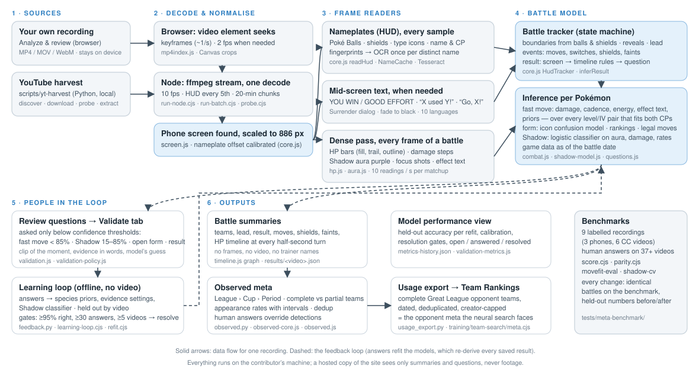

| Stage | What it does | Files | Browser | Node |
| --- | --- | --- | --- | --- |
| Decode | Frames from the recording. Browser: the video element seeks keyframe to keyframe (`mp4index.js` reads keyframe times from the MP4 index without decoding). Node: one ffmpeg stream per file at 10 fps, already cropped and scaled. | `ui.js`, `mp4index.js`, `tests/meta-benchmark/run-node.cjs`, `run-batch.cjs`, `decode-plan.cjs` | yes | yes |
| Locate the phone screen | Wide uploads embed the phone beside a facecam. Persistent vertical edges give candidate columns; the column where the battle HUD reads on the most frames wins. | `screen.js`, `probe.cjs` | yes | yes |
| Nameplates (HUD) | Both nameplates every sample: Poké Balls, shields, type icons, name and CP fingerprints; one OCR read per distinct name. | `core.js` (`readHud`, `calibrate`, `NameCache`) | yes | yes |
| Mid-screen text | Result screens, "X used Y!" and "Go, X!" banners, the surrender dialog, fades to black, in ten UI languages. | `core.js` (`bandStats`, `bannerBox`, `parseBanner`, `outcome`) | yes | yes |
| Dense pass | Every frame of a battle: HP bars, damage steps, Shadow aura, focus shots, effectiveness text. | `hp.js`, `aura.js` | yes (2× playback) | yes (every frame) |
| Battle tracker | Boundaries, reveals, lead, events and results from the HUD sequence. | `core.js` (`HudTracker`, `inferResult`) | yes | yes |
| Inference | Fast moves, forms and Shadow status from the evidence, with game data as of the battle date. | `combat.js`, `shadow-model.js` | yes | yes |
| Questions and Validate | Uncertain items become questions; answers are stored, scored and fed back. | `questions.js`, `validation.js`, `validation-policy.js`, `validation-metrics.js` | yes | questions written by `export-questions.cjs` |
| Learning loop | Refits priors, evidence settings and the Shadow classifier from saved evidence; held-out gates decide what may auto-resolve. | `scripts/yt-harvest/feedback.py`, `tests/meta-benchmark/learning-loop.cjs`, `refit.cjs`, `movefit-fit.cjs`, `shadow-cv.cjs` | | yes |
| Observed meta and exports | Battle catalog by league, cup and period; usage export for Team Rankings; deduplication. | `observed.py`, `observed-core.js`, `observed.js`, `usage_export.py`, `dedup.cjs` | yes | yes |

**Why two runtimes.** The browser version exists so that a contributor can analyse their own recording with nothing installed and nothing uploaded. The Node engine exists because a browser cannot decode hours of video quickly: it can only seek, it throttles hidden tabs, and it cannot run several files in parallel. The Node engine streams every frame once through ffmpeg, runs several files at once, caches OCR and probes on disk, and is what the YouTube harvester uses. Both call the same functions on the same 886-pixel-wide reference frame, so results agree.

**Reference geometry.** Every rule is written for a frame scaled to 886 pixels wide (the width of the first phone recording the prototype was built on). Wider or narrower screens are scaled to that width first; a vertical offset `dy` (found by calibration) absorbs cropped status bars. All coordinates below are in those reference pixels.

## 3. The frame: what is checked, where, and why

This section shows exactly what the extractor looks at. The figures are frames from two Creative Commons recordings (KZ FAM and PokeDeeGO, both CC BY), with the extractor's own boxes drawn by its own geometry functions.

### Locating the phone screen

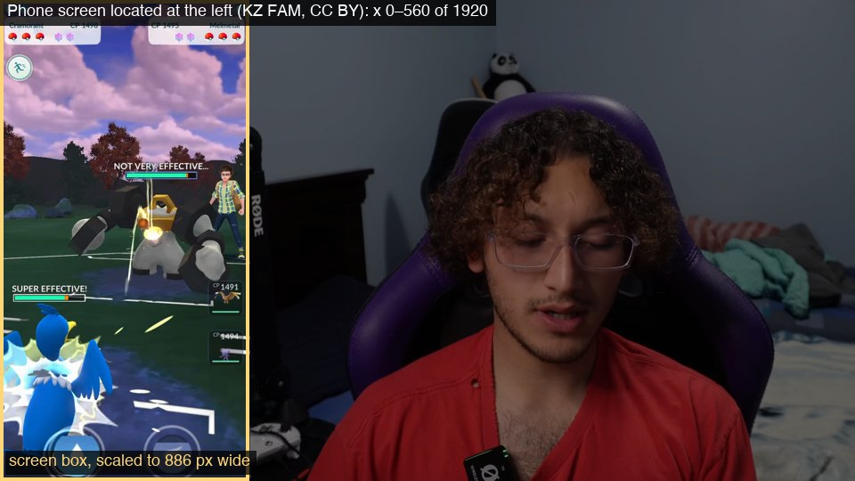

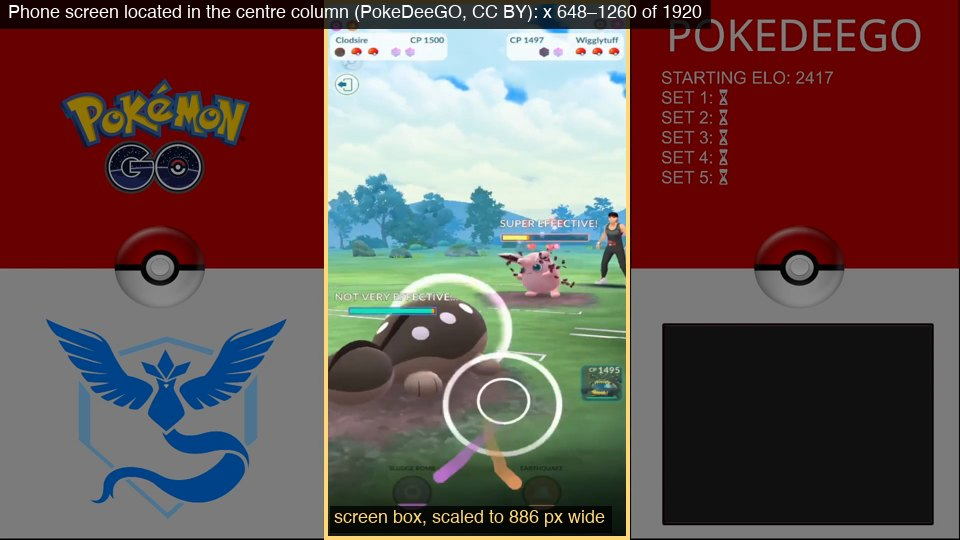

A phone recording fills the frame and needs no locating. A YouTube upload or stream usually puts the phone in a tall column beside a facecam, branding or a team card. `screen.js` samples frames across the range, measures how often each column of pixels is a sharp, persistent brightness step (`edgeProfile`, `peaks`), and tries each rectangle between candidate edges by reading the battle HUD inside it (`hudScore`). The rectangle where both nameplates read on the most frames wins. Four refinements came from harvest failures:

- A frame only counts if both name boxes hold text (at least 12 of the 64×12 fingerprint cells inked; real names have 100–200). A facecam panel with a palette of red dots once read as "Poké Balls" on more frames than the phone itself.
- `refine` fits the six Poké Ball centres by least squares over at least three frames and corrects the box when it is off by 0.8% or wider by 1.2%. Frame borders had made boxes 1–11% too wide, which pushed the opponent's third ball out of its box and merged battles.
- If nothing is found, strong-edge candidates are retried with each side moved in by 1–3% (a bezel line just outside the screen). This costs about 12 s on videos without a HUD.
- If that fails too, each frame's own strong edges are tried, kept only where the HUD reads inside them on that frame; the box that reads on the most frames (at least 20%) wins. The median search needs an edge in the same column on half the frames. Edited compilations place each battle clip a few pixels apart (Npoke: the right edge at 690–697 of 960 over five clips), and a dark arena against a dark backdrop hides the edge in most scenes (_bnPdUKMYpw: strong on 6 of 16 frames). Four Japanese Npoke uploads went from 0 to 19 battles (46 opponent species, 10 full teams) and the Spanish _bnPdUKMYpw from 0 to 11 (33 species, 11 full teams). One box still fits only the clips placed within about 2 px of it (see *Gaps*). This costs about 3 s more on videos without a HUD.

**Why not a learned detector?** The screen is a rectangle with hard edges and a known interior; edge statistics plus a functional test ("does the HUD read here?") are exact and need no training data. The functional test also doubles as the keyframe pre-screen (`probe.cjs`), which decides whether a video has battles at all before the expensive pass.

### Nameplates: Poké Balls, shields, names, CP and type icons

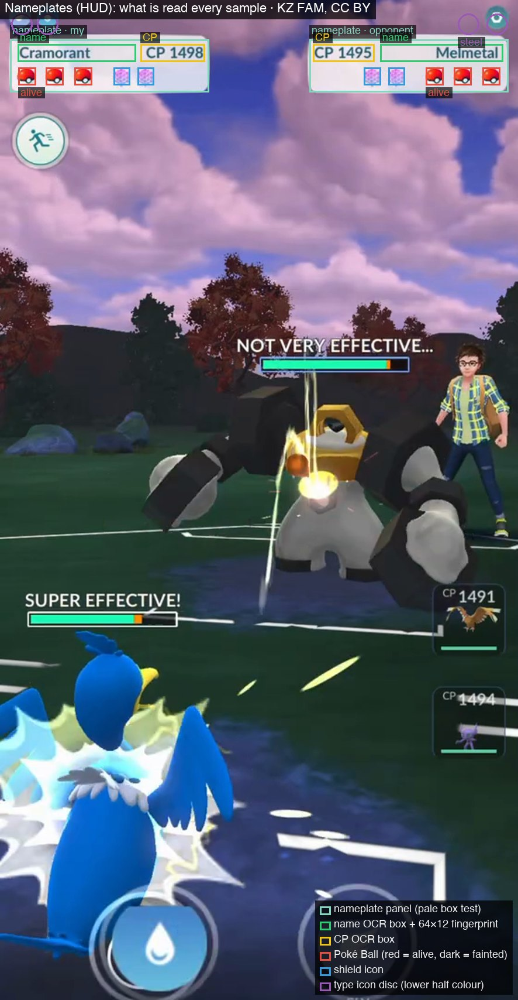

Both nameplates are read on every sampled frame (`readHud`). The geometry, in reference pixels:

| Element | Your side | Opponent | How it is read |
| --- | --- | --- | --- |
| Nameplate panel | 17–357 × 117–207 | 529–869 × 117–207 | mean colour must be pale and grey (all channels > 170, spread < 60); a pale menu card can pass, so readable Poké Balls are also required |
| Name box | 30–232 × 125–155 | 650–860 × 125–155 | 64×12 fingerprint of dark pixels (threshold halfway between the plate's median and its darkest 5%); OCR once per distinct fingerprint |
| CP box | 240–350 × 125–155 | 535–640 × 125–155 | fingerprint and OCR like the name; a CP read twice is reused while its digits look the same |
| Poké Balls | three 30×30 boxes at y 165–195 | same | mean colour of the inner half: red = alive, dark = fainted, else unknown |
| Shields | two 28×30 boxes at y 165–195 | same | blue and bright = shield still available |
| Type icons | discs at (37, 91), (81, 91), radius 18 | (801, 91), (850, 91) | median colour of the lower half of the disc, matched to 18 fitted type colours, rejected beyond a distance of 40 |

**Calibration.** Uploads crop the phone's status bar, which shifts everything up. `calibrate` tries vertical offsets from −120 to +160 (and −150 to −122 as a fallback) in steps of 2, keeps the offsets where the Poké Balls read (at least two red balls and five readable ones), and then centres the name boxes on the rows that hold the names' dark text. The offset is re-checked on frames where the HUD does not read (every 4th such frame until an offset has named a species, then every 20th), and proven offsets are tried first, because some videos change offset between battles. A wrong first calibration on a team card once cost a whole video its battles.

**Why fingerprints and a cache.** Names and CP change only when a Pokémon changes, yet appear on every frame. Reading a 64×12 fingerprint is a few hundred pixel reads; an OCR call is milliseconds in Node and far more in the browser. The `NameCache` reuses the OCR result for any plate within 6% of a fingerprint already read and retries unreadable plates up to three times, which brings text reads down to 16–33 per video.

**Why the type icons use only the lower half.** The phone's status bar can cover the top of the discs. Icons also lag a switch by up to a second, so votes are taken only once a name has held for two samples; on 368 benchmark samples colour alone was right 357 times, and all 11 misses were frames from the previous Pokémon or without icons. The figure shows a harder case: the recorder's own icons are hidden under the status bar and are not read, while the opponent's steel icon is.

### Battle boundaries from the HUD

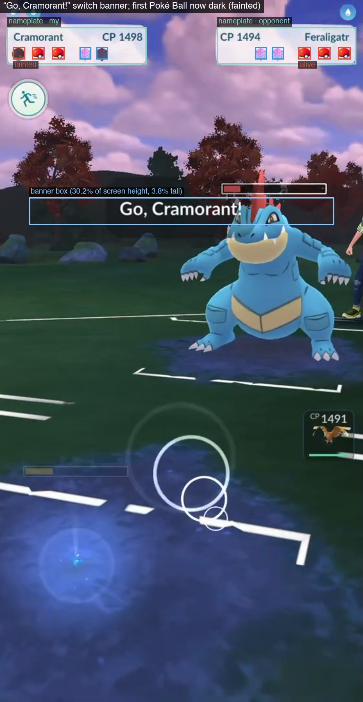

Within a battle, fainted balls and used shields can only increase. So a HUD with all balls red and both shields back on both sides is a new battle, and a gap in the nameplates (cutscenes hide them) continues the battle unless a result screen, a fade to black or a fresh HUD shows it ended. `HudTracker` is a small state machine over this sequence. Rules added from harvest failures, each verified by replaying recorded tracker inputs from 17 videos:

- A fresh HUD within 20 s of a battle's start, with the nameplates on screen throughout and nobody fainted, continues the battle (a misread shield while the HUD settles used to split off the first seconds).
- Two shields vanishing at once on one frame right before a fresh HUD is a misread: the icons hide as a charged attack starts. A real shield takes one.
- After a fade to black, a HUD returning at least 3 s later with fewer fainted Pokémon than the battle has seen starts the next battle (one video had the recorder's first ball misread as fainted on every frame, so no HUD was ever "fresh" and four battles merged).
- A battle seen on a single HUD frame that opened mid-battle is dropped when a later HUD closes it.
- A battle that opened on a HUD that wasn't fresh (the first frame after a fade with a shield icon still appearing or a ball read '?', or a misread while the HUD settles) and turns fresh within 20 s under the first two rules was seen from its start: it loses the "Recording starts mid-battle" flag. It used to keep the flag, so its full team was left out of the usage export ("lead unknown") and the lead questions, and the Poké Ball counter could not settle its result (asked as "mid-start").

### HP bars, damage trails and the dense pass

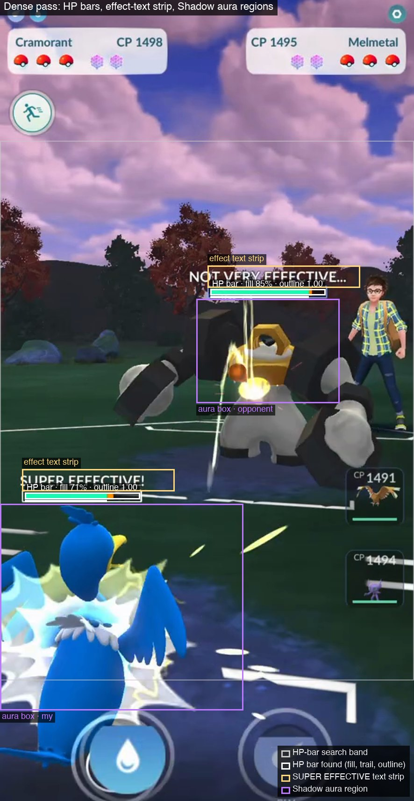

Each active Pokémon has an HP bar 253 px wide (246 px of fill) above it: teal above half HP, yellow, then red, with an orange trail that shows the HP just lost and drains over about half a second. The trail's jump is a clean measurement of one hit. Bars are searched in rows 300–1450 of the reference frame (`BAND`), because large Pokémon and short 16:9 screens put them as high as y ≈ 370.

`findBars` works in three steps:

1. **Classify pixels** by hue, not RGB distance: teal 148–186°, yellow 47–72°, red ≥ 344° or ≤ 12°, trail 20–46°, with value ≥ 0.7 and saturation ≥ 0.38. YouTube re-encoding shifts the teal fill from (30, 254, 194) to about (0, 228, 172), which the earlier RGB-distance test rejected.
2. **Find solid runs and link rows into blobs** 9–18 rows tall whose left edge wobbles by at most 2 px between rows and 4 px overall (blurred edges), tolerating 1–3 px gaps of compression ringing between fill and trail. Fill and trail ends are a trimmed mean over the blob's rows, which gives sub-pixel precision on small hits.
3. **Require the bar's outline.** Grass, attack effects and the Pokémon themselves make fill-coloured rectangles; on 223 YouTube and phone frames 55% of the "opponent bars" the old detector assigned had no outline. A real bar has a bright line (white for the opponent, light blue for the recorder) 2–10 px above or below the fill along at least half its width, brighter than the rows 3 px above and below it. The score is bimodal (94% of other blobs score < 0.1, real bars ≥ 0.9), so the best-outlined bar wins each side.

`assignBars` and `track` then decide which bar is whose: the recorder's bar starts near the left edge (x 30–80 on phones, 30–230 on screens of aspect ≥ 0.55: 16:9 phones and tablets), the opponent's mid-screen (230–600); the bar whose left edge recurs through a window is kept. In a charged-attack cutscene the attacker's bar is drawn centred (x ≈ 320) whoever attacks, so `track` (each side's HP series: fast-move hits, charged damage, the HP timeline and the results read from it) skips centred bars on every screen. `assignBars` (where the aura box and the effect-text strip go) skips them on wide screens only; on phones a centred bar still places the opponent's aura box, because the Shadow classifier is measurably better with it (*Centred bars on phones* below).

**Why the cutoff is 0.55 (2026-10-13).** It was 0.6 until videos just below it still lost your bar (hits on your bar in 6 of 15 matchups on L-FikW4OvnU at 0.56, 8/38 on lC6aiKQuZ5c, 10/35 on KuaffxQ-zTA at 0.58, against 12, 27 and 23 for the opponent). The usual left edge of each of your Pokémon's bars on 19 videos: phones up to 0.544, 52–78 (most ≈ 55); 16:9 screens (0.561–0.563), 56–150 (Zacian 56, Dialga 106, Zekrom 122, Lunala 150); 0.58, 74–99; 0.61–0.64, 56–140; 0.67, 126–142; 0.75, 154–160. Above 16:9 a bar moves right as the screen widens (about an offset from the centre ∝ 1/aspect), but it jumps at 16:9 (Zekrom 76 at 0.531, 122 at 0.561, where 1/aspect predicts 89) and differs between devices of the same shape, so a window that scales with the aspect either misses Lunala and Palkia at 0.562 or widens every phone window. A cutoff at 0.55 does neither. A lone centred bar matched your bar's last reading about as often as the opponent's (97 and 113 frames at 0.56–0.61), and under the phone rule it had become the opponent's series whenever it showed more often than their own bar ("hits" of 13–29% in 8 matchups). On 7 whole videos at 0.56–0.58, matchups with hits on your bar went from 104 to 175 of 243 (43% → 72%) and on the opponent's from 170 to 172; battle boundaries, species and results were unchanged, and phones below 0.55 and screens ≥ 0.6 take the same code path as before (11 checked, identical). Phones then still counted a centred bar as the opponent's everywhere; the next paragraph measures what changed when the HP series stopped doing so.

**Centred bars on phones (2026-10-13).** Every labelled phone video with a local file (92 of 95: 908 battles, 4,830 matchups) was re-extracted once and read three ways from the same frames: the old phone rule (A), centred bars skipped in both `assignBars` and `track` (B), and skipped in `track` only (C). C takes the aura and effect-text reads from A and the HP series from B, which `run-node.cjs` computes independently; on three 4-minute stretches it matched a real run of the new code exactly. Under A the opponent's series followed the cutscene bar in 696 matchups on 78 videos, 249 of them with "hits" (307, of 1.5–35%). Under B and C those matchups follow the opponent's own bar (311 hits), and no series can follow a centred bar. Held out by video (`movefit-eval.cjs` with the current evidence settings, `shadow-cv.cjs` leave-one-video-out; 196 fast moves, 31 forms and 391 Shadow answers on 127 videos):

| | A (before) | B (skipped in both) | C (skipped in `track`: adopted) |
| --- | --- | --- | --- |
| Fast moves | 169/196, log-loss 0.317; p ≥ .90: 104/105 | 171/196, 0.311; 106/107 | **171/196, 0.311; 106/107** |
| Fast moves, evidence settings refitted (nested 4-fold) | 167/196, 0.354 | | **170/196, 0.341** |
| Forms | 25/31, 0.302 | 25/31, 0.299 | 25/31, 0.299 |
| Shadow classifier, refitted per fold | 317/391, 0.415, AUC 0.890 | 313/391, 0.421, AUC 0.885 | 317/391, 0.415, AUC 0.890 |
| Shadow, current fitted model unchanged | 323/391, 0.385, AUC 0.908 | 318/391, 0.391, AUC 0.904 | 323/391, 0.384, AUC 0.908 |

Paired by answer, C against A: two fast moves go from wrong to right and none the other way (log-loss −0.006, 95% video bootstrap −0.019 to 0.000), and Shadow is unchanged (log-loss within ±0.001). B loses Shadow accuracy beyond noise on phones (log-loss +0.009, interval +0.001 to +0.021; AUC −0.005). The aura box under a centred bar sees whichever Pokémon the camera frames, and those close-ups carry Shadow evidence the classifier uses, so `assignBars` keeps the phone rule. Refitting the evidence settings (`movefit-fit.cjs`, as the learning loop does) gives identical parameters on A, B and C evidence, so the change needs no refit. Battle boundaries and species are unchanged on all 92 videos, and the seven phone recordings of the labelled benchmark score identically.

Results differ in 19 of 908 battles. Thirteen "faints" wins under A came from the defender's bar emptying in the final cutscene, read as the opponent's series. They now go to review: 12 with the guess that you won (the one that has an answer was a win), and one closed as unresolvable. One battle gained a "faints" result, and 5 "unresolvable" endings became questions with a guess. The `knockout` rule (section 4) now reads that final knockout from the centred bar: 12 of the 13 are asked with the guess that you won, and it settles them on its own once owner answers pass the promotion gate.

HP never rises within a matchup, so the fill is read as a descending staircase: upward readings (an attack glow sweeping over the bar) are ignored, a step counts once two readings confirm it, and a step must also clear three times the series' median frame-to-frame jitter (heavy compression makes the fill end flicker by 1–3%). Damage that appears after the bars were hidden for more than 1.2 s is a charged attack and is excluded from fast-move hits. All of this is documented with before/after numbers under *HP bars on YouTube footage* in section 7.

### The Shadow aura and focus shots

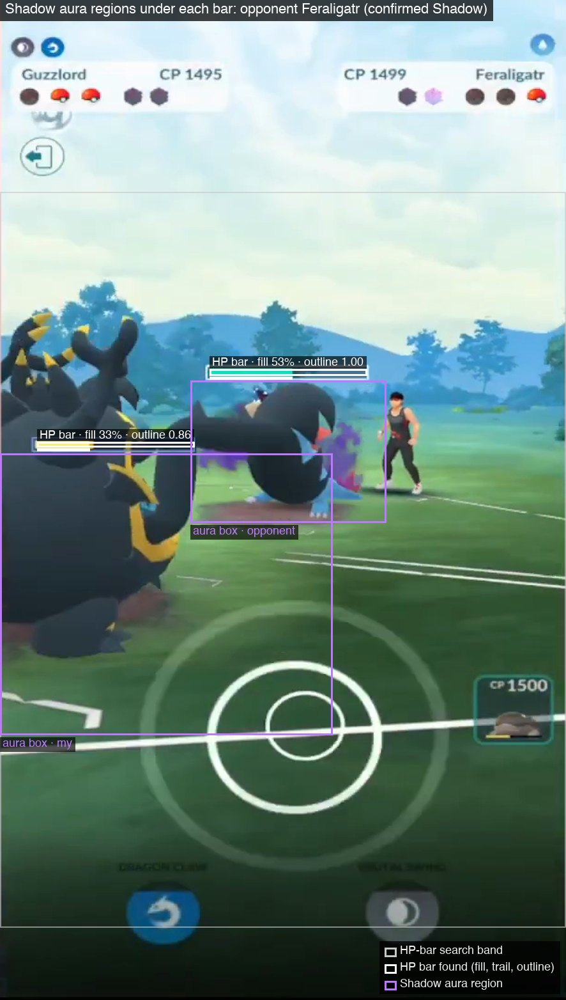

Shadow Pokémon carry dark violet flames. Each side's Pokémon stands just below its HP bar, so `aura.js` measures the share of aura-purple pixels (hue 262–305°, saturation ≥ 0.38, value 0.22–0.85) in a box placed relative to the bar: the opponent's in a box 30 px wider than its bar and 230 px tall below it, the recorder's in the larger foreground area (0–520 × bar + 10 to bar + 450). Each matchup is summarised by the *median* over its frames, so a one-off Shadow Ball or Psychic effect does not dominate. A red-eye cue was tried and dropped (AUC ≈ 0.5: the eyes are a few pixels and red attack effects swamp them).

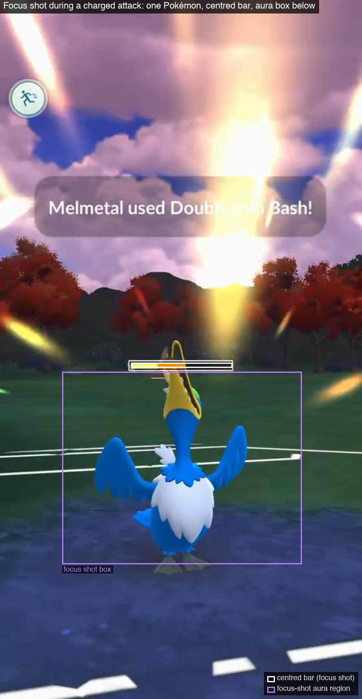

The aura box has a known flaw: the recorder's Shadow flames spill into the opponent's box, and the opponent's box even shows the recorder's Pokémon while the camera frames it. During a charged attack the camera frames one Pokémon at a time: the attacker as it launches (from the "X used Y!" banner, about a second) and then the defender as it is hit. That Pokémon fills the view with its bar centred above it, and the other side is out of frame. `measureFocus` measures the box under a centred bar when the recorder's usual bar is absent; `focusMoments` groups these frames into shots, names attacker and defender from the banner, and assigns shots without a banner by matching the centred bar's fill to one side's fill just before. Shielded defenders (the pink bubble reads as purple) and ghost, dark, poison and psychic moves (purple effects) are skipped. On labelled Pokémon with shots, median focus purple is 0.0% for regular and 14% for Shadow Pokémon (AUC 0.91), and 0.94 for opponents facing the recorder's own Shadow, where the plain aura box scores 0.75.

### Effectiveness text

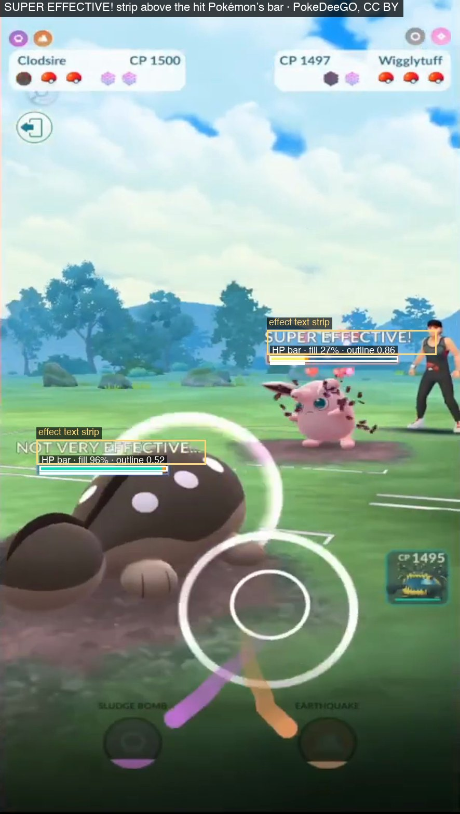

When a fast attack lands, the game flashes **SUPER EFFECTIVE!** or **NOT VERY EFFECTIVE…** in white just above the target's bar. Every dense frame fingerprints the strip from 6 px left of the bar to 320 px right of it and 3–50 px above it (96×12 cells of near-white pixels). The strip is read by OCR only when it looks like text: 3–45% of the strip lit, with ink in every one of rows 1–4 (the words sit in the top five rows; arena glare and the bar's own edge light the lower rows). Each distinct look is read once and cached; after a successful read the side is not read again for 0.9 s. On a 150 s clip this cut OCR reads from 257 to 50 with the same detections. The texts feed the fast-move likelihood (section 4): they separate moves with equal damage but different types.

### Charged-attack and switch banners

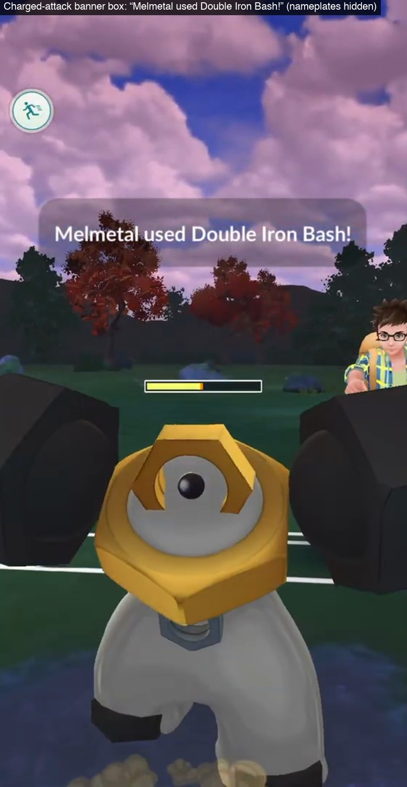

The banner sits at 30.2% of the full screen height and is 3.8% tall, between x 71 and 815; when the top is cropped, the box is recovered from the calibration offset. It is read with or without nameplates on screen, when its share of white letters looks like text (English) or, for Japanese, Korean and Chinese UIs whose thin strokes are pale blue on a light sky, when the box shows sharp brightness steps (2.5–3.4% of pixels on banners, ≤ 1.8% otherwise). A tolerant parser picks "X used Y!" or "Go, X!" out of OCR junk from bright arenas, tolerating one wrong letter, resolves the actor through the species dictionaries and the move through `move-names.json` (PvPoke moves by English name, with PokeAPI's localised names, 348 of 352 moves). A move is credited to a side only when the actor uniquely matches one side's revealed team; mirror matches stay unassigned. "Go, X!" banners mark switches and entries, which give each Pokémon's fighting time for the energy accounting.

### Result screens, the surrender dialog and fades

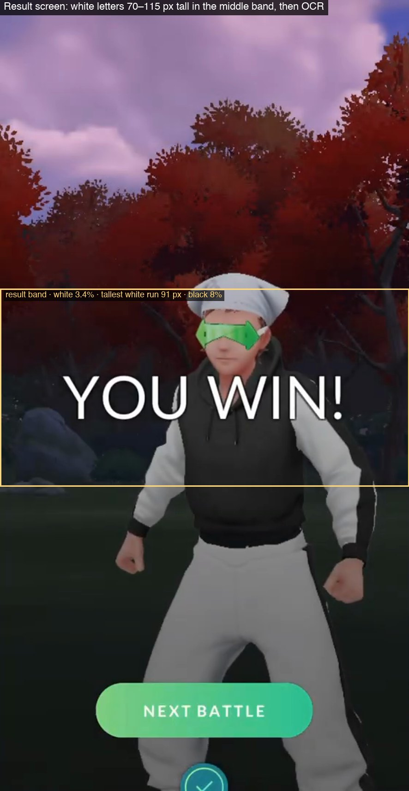


Rows 700–1180 of a 1920-tall reference frame are the band where the game shows results, the surrender dialog and the fade to black. `bandStats` measures the share of white and black pixels and the tallest run of rows with white in them, which decides without OCR what the band could be:

- a **result candidate** has at least 1% white and a tallest white run of 70–115 px (the height of YOU WIN / GOOD EFFORT letters): then OCR reads it, with one wrong letter tolerated for 6+ letter phrases and exact matching for short ones ("WIN!" on Japanese and Korean screens, which are in English letters). Chinese screens are re-read with the `chi_tra` model;
- a **surrender candidate** is at least 50% white: OCR must then find "Surrender and exit?" (or its translation) and the HUD must vanish within 3 s;
- a **fade** is more than 90% black.

Result screens are read only when the battle can have ended: a side down to its last Pokémon, a fade, or 8 s without nameplates. The reason is visible in the focus-shot figure above: the big white move name in a cutscene also passes the result pre-test (81 px run), and reading results everywhere produced false endings. Matchmaking text ends the search. A win read while the opponent still had Pokémon is flagged as a probable early exit.

## 4. How each answer about a battle is produced

| Metric | How it is determined | Evidence used | Main gaps |
| --- | --- | --- | --- |
| Battle boundaries | Nameplates every ~1 s (browser) or every 5th frame at 10 fps (Node); fainted balls and used shields only increase within a battle; fresh HUD = new battle; gaps continue the battle unless a result, fade or fresh HUD ends it | Poké Balls, shields, result screens, fades | a recording that starts mid-battle; two battles back to back with no visible reset (never seen) |
| Opponent species | OCR of the name box once per distinct fingerprint, matched to PvPoke's species list in the video's language (exact, or one wrong letter as a suggestion for names of 5+ letters), kept after two sightings | nameplate text | Pokémon on screen under ~2 s; nicknames (impossible for opponents) |
| Lead | the first opponent species seen in the battle | first stable nameplate | an opponent swapping within the first second; "Go, X!" banners could settle it |
| Team | every species revealed; complete only when all three appeared | nameplates | the third Pokémon is often never sent out |
| CP | the CP box, read and cached like names; majority vote per Pokémon | CP text | none significant |
| Result | a result screen, read only when the battle can have ended; otherwise the timeline rules below; otherwise a question | result screen, ball count, HP bars, surrender dialog, fade | uploads that cut result screens and have an undecided timeline |
| Forfeits | yours: the surrender dialog, then a loss; the opponent's: a win before all their Pokémon fainted | dialog, ball count | leaving the app without the dialog; a disconnect looks like a forfeit |
| Shields used | shield icons on each nameplate; counts only increase | HUD | none significant |
| Form | type icons through a confusion model, PvPoke ranking prior, charged-move legality, reviewer answers | icons, rankings, answers, banners | forms with identical types and no deciding move (Dialga vs Dialga Origin) |
| Shadow | a logistic classifier over aura, focus shots, damage ratios, species rates and ranking differences | HP bars, aura, answers | Shadows whose flames are never in a box; purple-bodied species; low-resolution uploads |
| Fast move | likelihood over damage, cadence, energy, effect text and priors, over every level/IV pair consistent with both CPs | HP bars, CP, banners, effect text, rankings, answers | pairs that hit equally hard on the same turns; edited videos that cut the bars |
| Charged moves | "X used Y!" banners, checked against the form's legal moves | banner text | a banner missed during a fast cutscene |

### Species: OCR, or a classifier?

Only a few hundred names can appear, in one font at fixed positions, so reading a name is a closed-set classification problem, and a small CNN would be faster and more robust on blurry video. The decision was to keep OCR, for evidence and for cost:

- after the geometry and caching fixes, OCR reads every labelled opponent species correctly (194 of 194 plus 39 of 39), and every past naming error came from a box clipping "Mega Garchomp" or a fingerprint threshold on blurry video, not from reading;
- OCR is cheap once cached (16–33 reads per video) and run time is dominated by decoding, not text;
- other UI languages are language packs for Tesseract, while a classifier would need new renders per language. Japanese, Korean and Chinese nameplates are read with that language's fast model, and `NameLanguage` switches a video's language after two exact matches, so English videos keep their results.

A local vision model (`scripts/freellm`, `qwen2.5vl:7b`) passed its quality gate as a *second reader* for nameplates (108 of 108 names on 92 Creative Commons HUD strips, none invented) and is used only where the OCR is unsure.

### Results without a result screen

Owner's rule: ask the result question only when the answer is not confident. `inferResult` puts every battle without a read result screen into one of three outcomes. The precisions come from 1,422 read results and the owner's 51 answers (`result-policy.cjs`):

| Outcome | Condition | Guess | Precision | Question? |
| --- | --- | --- | --- | --- |
| confident `faints` | counter at 3 for one side, battle seen from its start | that side lost | 41/41 | no |
| confident `faints` | counter 2 vs ≤ 1, that side's last bar empty ≤ 3 s before the end, other ≥ 10% | that side lost | 67/67 | no |
| confident `surrender` | "Surrender and exit?" dialog, HUD gone within 3 s | you forfeited | 118/118 | no |
| uncertain `fade` | fade to black after the last HUD, both sides alive | opponent forfeit | .71 (10/14) | yes, guess shown |
| uncertain `tie` | counter 2 vs 2, one last bar empty | the empty side lost | .84 (41/49) | yes |
| uncertain `mid-start` | counter 3 but the recording began mid-battle, bars disagree | counter's loser | .47 (7/15) | yes |
| uncertain `unread` | a result-like screen OCR could not read | by the counter, else opponent forfeit | .5 | yes |
| uncertain `both-alive` | older saved result (no fade recorded), both bars alive at the end | opponent forfeit | .46 (11/24) | yes |
| uncertain `knockout` | counter 2 vs ≤ 1, the centred bar of the final charged-attack cutscene empty ≤ 3 s from the end, other side's own bar ≥ 10% | that side lost | .96 (74/77 read screens; owner 7/9) | yes, until promoted |
| unresolvable | none of the above, no fade, next battle's HUD within 10 s or the recording ends | – | – | no (closed by policy, reversible) |

Timer endings cannot be told from a fade because the clock is not read. The rules learn: `ruleStats` re-runs every rule on every human result answer at each refit (the rules are fixed, so every answer is held out), and an uncertain rule is promoted to confident at ≥ 95% right on ≥ 30 answers from ≥ 5 videos, and demoted again below that. Observed meta and the usage export treat confident inferred results like read ones.

**Knockout in the final cutscene (`knockout`, 2026-10-13).** The last knockout of a battle often happens inside a charged-attack cutscene. There the defender's bar is drawn centred while it is hit, and `track` leaves centred bars out of both sides' HP (section 3), so the confident two-fainted rule above cannot see it. `run-node.cjs` therefore saves, per battle, every centred bar from 8 s before the battle's end to 4 s after (`cutsceneBar`: time, fill and height; about 12 readings), and refits apply the rule to saved results without video. The rule: the counter shows 2 fainted on one side and at most 1 on the other, the centred bar's median over its last second of readings is empty, that last reading is within 3 s of the end, and the other side's own bar is at ≥ 10%; then that side lost. Run as if no result screen had been read, it agrees with 74 of 77 read screens on 122 re-extracted labelled videos (phones 52/54, wide screens 22/23; wins 45/46, losses 29/31) and with 7 of 9 owner answers on 6 videos (both misses were forfeits). It is an uncertain rule like `fade` and `tie`: it asks with its guess until owner answers pass the promotion gate (≥ 95% on ≥ 30 answers from ≥ 5 videos), then settles on its own. On the 92 phone videos it guesses in 59 battles (43 wins, 16 losses), 12 of them the wins the old phone rule had settled from the cutscene bar (section 3); the one of those with an answer was a win. No battle gets a confident result from it before the gate passes, and the nine benchmark recordings score as before. The browser samples only the first 30 s of each matchup and records no cutscene readings, so the rule applies to Node runs.

### Regional forms from type icons

Forms with different types (Galarian Corsola is ghost; regular Stunfisk is ground/electric) are separated by the icons; forms with identical types cannot be. Three sources of evidence are combined per Pokémon:

1. **An icon confusion model.** On 1,589 Pokémon whose species fixes their types, the majority icon reading matched the true types only 60% of the time: a dual type reads as a single type in 47% of frames, and some videos shift colours (fire read as ground 10% of the time; 0 of 9 in the worst video). An exact-match filter therefore threw away most of the evidence. `ICON_CONFUSION`, P(read type | true type), fitted on those 1,589 Pokémon and adapted to each video's own unambiguous Pokémon (weight 200 votes), scores every form, allowing missed icons and colour shifts. Frames repeat the same misreading, so the icon evidence counts as two independent reads.
2. **A ranking prior.** Look-alike forms are weighted by PvPoke ranking score for the battle's league, `exp(Δscore / 2)` (temperature 4 → 2 after the v4 refit), and by reviewer form answers. The league comes from the nameplate CPs when they rule out the video's league: Master League Dialga was being called regular with p = 1.00 three times because Great League rankings were used.
3. **Moveset legality.** A charged move the form cannot learn rules the form out (Weezing and Galarian Weezing share no charged moves); Frustration means Shadow, Return means not Shadow.

Pokémon without a matchup get a prior-only answer rather than none. Ablations on the 31 labelled forms (video-grouped cross-validation): without icons 22/31 (log-loss 0.50), ranking temperature 4: 24/31 (0.30), without the CP league 21/31 (1.15); v4 with everything 25/31 (0.26).

### Fast moves from HP bars

Each fast-move hit is a step down the target's bar. Its size is compared with PvPoke's damage formula, `⌊power × STAB × attack/defense × effectiveness × 0.5 × 1.3⌋ + 1` (a Shadow attacks at ×1.2 and defends at ×0.833), over **every level/IV combination consistent with both nameplate CPs** (`statCombos`; up to 40 spread combinations per side). One combination per side must explain both directions at once: its attack sets the damage it deals, its defence and HP the damage it takes. Four more terms make the per-move likelihood (`inferMatchup`, parameters in `FIT`, fitted by coordinate search on video-grouped log-loss with `movefit-fit.cjs`):

- **Damage noise** proportional to the hit: σ = 1.3% of HP + 15% of the hit, with 15% stray readings and a ×0.92 scale (the measured/predicted ratio under the true move has median 0.96 and IQR 0.85–1.18, because the CP leaves a stat range and steps merge). A fixed σ of 0.65% had made a 14% Incinerate measured at 13% a "stray reading".
- **Gap likelihood** instead of a single cadence mode: each gap between hits is a whole number of moves (later moves missed with probability q = 0.2 each), a pause, or a stray detection, with τ = 0.2 s timing jitter. Only 46 of 197 labels had a gap mode equal to the true move's duration, so the old mode test often pointed the wrong way.
- **Energy accounting** (`energyFactor`): all energy spent on charged moves must have been earned by fast moves during the Pokémon's fighting time, measured as clock time on the field (entry to next switch, minus 5 s per charged-attack cutscene). Counting only frames with a visible bar had made 15% of true moves "impossible" on YouTube footage, where bars are found in a median of 24% of matchup frames. A move that cannot pay gets weight 0.05.
- **Effectiveness text** as a likelihood term: P(super text) = .25 for a super-effective move, .03 otherwise, and symmetrically for "not very"; P(no text) .72 / .94. The text is brief and often missed, so no reading is certain and a missing text says little; a stronger P = .80 was overconfident (log-loss −0.473 vs −0.334).
- **Priors**: PvPoke's recommended moveset and simulated usage, worth one human label (not four: species-level human answers are the better guide), reviewer answers per species, and charged moves matching PvPoke's recommended set, which double that set's fast move. Matchups with the same opponent Pokémon in a battle are pooled as `sum / n^0.7`; the recorder's own Pokémon are pooled across all battles in the recording.

Window: the whole matchup is used for charged hits and the aura, but fast-move hits come from the first 12 s of a matchup; later readings (low-HP colours, cutscene edges) add noise (whole matchup 79 vs first 8–18 s 86–87 of 99 right in the v3 measurement).

**Example.** Claydol (CP 1492) against Guzzlord (CP 1498) hit for 5.6–6.0% every 3 turns: Mud Slap predicts 5.2–6.2% per 3 turns; Confusion and Extrasensory do not fit.

### Fast moves and forms from 228 human labels

This is the v4 evidence model (2026-10-11), measured by video-grouped cross-validation on 197 confirmed fast moves and 31 confirmed forms over 37 videos (`movefit-eval.cjs`; each video refit with priors from the other videos only). The old model's failures and the changes that fixed them are the list above. Ablations, turning only one change off:

| Change (ablation) | Fast moves | log-loss |
| --- | --- | --- |
| v4, all changes | **162/197** | **0.426** |
| without gap likelihood (old cadence) | 156 | 0.474 |
| with the old damage noise | 158 | 0.465 |
| without energy (impossible totals not penalised) | 158 | 0.458 |
| PvPoke prior worth 4 labels | 162 | 0.450 |
| without icon evidence | 160 | 0.451 |

Before → after, same labels: fast moves 153/197 (log-loss 0.575, ECE 0.048) → 162/197 (0.426, 0.033); forms 15/31 (1.93) → 25/31 (0.263). A nested 4-fold refit (parameters fitted without the test videos) gave 160/197 (0.441), so the gain is not an artefact of tuning. The HP-bar detector rework (section 7) then raised fast moves to 165/197 (0.393), and a refit of the evidence settings on the new hits (2026-10-12: relSigma 0.08 → 0.15, timing weight 0.5 → 0.25, q 0.35 → 0.2, τ 0.12 → 0.2, learnWeight 1 → 0.5) to **166/197, log-loss 0.339** (nested: 165/197, 0.376); at p ≥ 0.90, 102 of 103 right. Forms are 25/31 (0.303) after that refit.

`inferMatchup` computes each move's per-hit likelihood once per stat combination and multiplies, instead of scoring every (move, move, combination) triple; results are identical and a refit of all 37 labelled videos takes 5 s instead of 21.

### Shadow status

Shadow is the hardest field. Damage carries the ×1.2 multipliers, but within one CP the attack stat varies by about ±8%, which blurs a 20% effect: per battle, the estimate for a known Shadow ranged from 4% to 100%. Three generations of evidence are combined today:

**Visual Shadow detector** (`aura.js`, 2026-10-10). The purple share under each bar entered as a likelihood ratio from two bands fitted on the answers (purple < 0.1%: 3 Shadow vs 26 regular; ≥ 0.1%: 10 vs 2). Leave-one-out on 33 answers, Shadow calls went from 27 to 30 right on top of damage and learned priors. Species whose body reads purple (Drapion) were excluded by a rule that turned out to be a bug: one "not Shadow" answer with purple ≥ 0.1% switched the aura off for that species for good, and on live data 19 species were flagged, usually because the recorder's own Shadow flames spilled into the box.

**Shadow classifier** (`shadow-model.js`, 2026-10-11). On the questions people had answered, the old estimate's Shadow pick was right only about half the time, for four measured reasons: the recorder's own Pokémon never used the aura (yet that side separates best, AUC 0.91); the aura was two bands, so 10–18% purple (an unmistakable flame) was outvoted by noisy damage; the purple-bodied rule above; and damage cannot tell which side is the Shadow (a Shadow on either side scales both directions by 1.2; damage alone has AUC 0.62, species priors 0.53). The replacement is an L2-regularised logistic regression (plain JS Newton steps, L2 = 8, missing values imputed at the training mean so they move nothing) over: the old posterior; target and other-side aura (log purple), the side and its interactions; the share of matchups with ≥ 0.5% purple; damage evidence conditioned on the other side's estimate; the species' high-purple rate in unlabelled footage (a per-species baseline instead of the exclusion rule); PvPoke's Shadow-minus-regular ranking score; and the focus-shot features. It runs after `MetaAura.applyToBattle` in Node, the browser and refits, and rescales each Pokémon's Shadow rows to the new probability as a likelihood ratio within each form, so form probabilities stay as the form model left them (an earlier version moved probability between forms and flipped Hisuian Typhlosion and Palkia Origin).

| Leave-one-video-out | Old posterior | Classifier (208 labels, 35 videos) | + focus shots (410 labels, 125 videos) |
| --- | --- | --- | --- |
| Right | 130 (62.5%) | 155 (74.5%) | **323 (78.8%)** |
| Log-loss / Brier | 0.653 / 0.230 | 0.513 / 0.169 | **0.461** |
| AUC | 0.685 | 0.814 | **0.870** |
| Your Pokémon / opponents | 23/43, 107/165 | 36/43, 119/165 | 63/73, 260/337 |
| Opponents facing your Shadow | | | 98/120 (AUC 0.886, was 0.774) |

Out-of-fold calibration: predicted 0.07 / 0.20 / 0.40 / 0.60 / 0.80 / 0.94 → observed 0 / 0.20 / 0.43 / 0.55 / 0.86 / 0.82. With aura and hits both measured it is 115/144; with neither 19/32, barely above the prior. Features were chosen by video-grouped CV over L2 4/8/16 and focus-feature sets; `focusMax`, `sideFocusT` and attacker/defender splits added nothing. Pokémon without focus shots (runs analysed before shots were recorded, or videos with no centred bars) are judged against thresholds from held-out predictions with the focus features removed.

**Forms without a Shadow variant.** PvPoke's game master lists `<id>_shadow` only for forms with a released Shadow, so "this form id has a `_shadow` entry" is the eligibility rule (`shadowEligibility`). An ineligible Pokémon gets no Shadow question, its probability is set to 0, and the learning loop resolves its open Shadow questions as "No" with the reason "form has no Shadow variant" (reversible, re-derived on every refit, with the dated game master the run was fitted with).

### Move data from the battle date

Fast moves are rebalanced over time (28 fast moves changed between March 2025 and October 2026: Charm 15 → 12 power, Mud Slap 12 → 11). Damage is fitted with PvPoke's game data as of the battle date: the browser fetches `gamemaster.min.json` at the last PvPoke commit on or before that date and falls back to current data, saying so; the harvester caches dated copies in `~/.cache/gbl-synapse/gamemaster/`. With current data, a March 2025 Claydol looked 53% Shadow (its Mud Slap hits seemed 9% too strong); with March 2025 data it is 0%, matching the reviewer.

### Using every appearance

- A **matchup** is any stretch where the same two Pokémon face each other for at least 3 s.
- Every matchup of the same opponent Pokémon in a battle is pooled (`combineMatchups`, tempered by n^0.7). An opponent that leads Skeledirge, switches out after a second and brings it back later gets its fast move, Shadow status and CP from the later appearance.
- Type icons are voted over every stable frame of the battle, not only the first.
- The recorder's own Pokémon are pooled across every battle in the recording: their team is the same Pokémon throughout.
- Opponents are never pooled across battles: a different battle usually means a different trainer.

### HP at every turn, and the timeline graph

Each battle gets an HP timeline (`hpTimeline`): every Pokémon's remaining HP at every half-second turn from the battle start. Readings are the dense samples of every matchup the Pokémon was in, smoothed with a median of 5 and fitted with the best non-increasing curve (pool-adjacent-violators), because HP never rises within a battle and a single misread low value must be averaged away rather than become a floor. Before entry the value is empty; on the field without readings, full; between readings, held; after a faint, 0. Stored summaries carry it as whole percents. `timeline.js` draws it as an SVG with two panels (your team above, the opponent below), one line per Pokémon ending at its faint, and markers for charged attacks, shields, faints, switches, effective hits and the result. The graph appears in each battle card, in Validate once a video is validated, and in Observed meta for each occurrence.

## 5. Learning from people

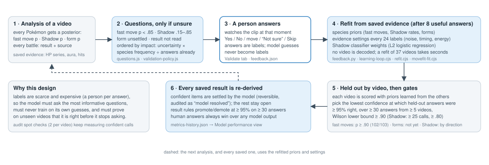

### Review questions

After an analysis, `questions.js` turns the uncertain parts into short questions with the evidence to look at: a regional form the icons could not settle (top form p < .85), a Shadow estimate between .15 and .85 (or with no measurable fast moves), a fast move below .85, and a battle result the timeline could not settle. Each question carries the clip of the longest matchup (12 s), three frame times, the evidence in plain words ("Measured 5 hits of about 6% HP, every 3 turns"), the model's confidence per option, and "Not sure" (recorded, changes nothing) and "Ask later". Questions about your own Pokémon are asked once and applied to every battle. Answers restrict the joint posterior (confirming Shadow can settle the fast move), set the species id once form and Shadow are known, and are kept in each battle's `reviewLog` so they can become benchmark labels.

**Why these thresholds.** They are the points where the held-out accuracy of the top pick drops below what the project accepts without a check (section 7, calibration): above .85 the model is right far more often than not, and asking there would spend reviewer time on questions it would mostly get right.

### Validate view and the learning loop

The **Validate** tab lists every open question from any source (your own analyses, the harvester) and works without video: a question from a harvested video plays its moment in an embedded YouTube player (or links to a YouTube tab), and a local recording can be opened to see full frames. Questions are ordered by an impact heuristic (`validation-policy.js`): uncertainty × a per-kind weight × √(how often the species appears) ÷ (1 + answers already given for that species and kind), with bonuses for questions that apply to all battles and for audit checks. **Priority**, **Type** and **Video** modes reorder the same queue.

Answers are durable (atomic writes in the work directory, a browser retry journal; on claude.ai the artifact's shared store). After eight new useful answers, `feedback.py` refits from saved evidence (never video): species priors (`learnedFromAnswers`: confirmed fast moves blend with PvPoke's prior, confirmed Shadow answers set the species' Shadow share), the Shadow classifier weights, and, every 24 new fast-move/form answers, the evidence settings (`movefit-fit.cjs` → `learning/movefit-params.json`, applied as `learned.fit`). Corrections and league changes refit sooner. Every refit re-derives every saved result and appends a record to `metrics-history.json`.

**Championship footage with two phone screens.** `probe.cjs` finds a second phone of the same size (`secondScreen`) and `harvest.py` analyses the LEFT screen as the creator's battle by default (`perspective_crop`, `league.left_screen`): no question. A reviewer's earlier perspective answer always wins (left/right pick that screen; single, switches and "not a championship" leave the probe's screen). Weak championship words (`possibleChampionship`) plus two distinguishable screens also set the championship format (`refine_video`). The "perspective" question (`validate.perspective_reason`) is asked only when (1) one screen is shown and the championship evidence is weak, so it may be ordinary GBL, or (2) two screens were reported but the probe could not tell them apart (boxes overlapping by more than 30%), so there is no reliable left screen. One screen with strong evidence needs no question. `python3 validate.py withdraw-perspective <work dir> [--dry-run]` moves open questions the rule no longer asks into a backup (reversible) and lists `reanalyse`, the videos whose stored crop is not the left screen, for requeueing.

### What the model may settle on its own

Model resolutions leave the open queue but remain in a reversible **Model resolved** audit; a human answer always replaces them, and they are never labels. The gates, all measured out of fold by video:

| Kind | Rule | Current state |
| --- | --- | --- |
| Fast move, form | the lowest confidence threshold at which held-out answers were ≥ 95% right at that threshold and every higher one, over ≥ 30 answers from ≥ 5 videos, Wilson 95% lower bound ≥ .90, never below .90, margin to the runner-up ≥ .8; the label-free model (priors from traceable labels only) must agree | fast moves resolve at p ≥ .90 (102/103 held out); forms do not qualify (21 answers at the threshold, 30 needed) |
| Shadow | per direction: the classifier's held-out calls in that direction ≥ 95% right at that confidence, over ≥ 25 calls from ≥ 5 videos, lower bound ≥ .80; separate thresholds for Pokémon without focus shots | "not Shadow" at ≥ .72 (128/134), "Shadow" at ≥ .94 (27/28; chosen without the test video 14/16, so thin) |
| Shadow, by form | a form with no Shadow variant is never Shadow (deterministic rule) | resolves as "No" with the reason |
| Result | confident timeline rules (table in section 4); uncertain rules promoted at ≥ 95% on ≥ 30 answers from ≥ 5 videos | faints and surrender confident; fade, tie, mid-start, unread, both-alive asked with the guess |
| Audit | two deterministic confident-call spot checks per video stay open until a person answers | keeps measuring confident calls |

The old gates (posterior ≥ .98, four hits, eight same-species labels, 50 held-out checks) were kept for anything not covered above; on this data they never passed (calibration counted one answer per video and needed 50).

### Model performance view

Validate's second view charts the per-refit history: held-out accuracy per kind with the change since the previous refit, Shadow AUC and log-loss against the old posterior, stacked human-answered / model-resolved / open counts, calibration panels for the latest refit, the resolution gates in words, and the offline milestones (v4 moves, the Shadow classifier, HP bars, focus shots). Every chart has a crosshair, arrow-key reading and a data table. The history is backfilled from `learning/refit-N/` for refits that ran before it existed, marked `backfilled`.

### Assistance from a local vision model

`scripts/freellm` routes bulk, checkable work to a local Ollama vision model; nothing leaves the machine. A task type is delegated only after passing a gate of ≥ 95% exactly right on the owner's answers held out by video, every delegated answer is checked by a script or by two independent calls that agree, and resolutions are reversible and never labels. Only nameplate reading has passed; no Validate question kind has, so the model resolves no questions today.

## 6. Other game languages

Harvested uploads come from phones in many languages. Before 2026-10-11, 101 of 102 Japanese-titled, 39 of 41 Korean and 20 of 20 Chinese videos gave no battle, because no nameplate matched the English list and the tracker keeps only battles with a species. German UIs read 1.39 opponent species per battle against 2.49 for English, and no German, Spanish or Portuguese result screen was ever read. The fixes:

- **Species names** in Japanese, Korean, Chinese (traditional and simplified), German, French, Spanish and Italian from PokeAPI (`species-names.json`, keyed by Pokédex number, mapped to the same PvPoke entries; Mega and Primal carry the language's prefix). Latin-script names are matched on the English OCR text; CJK plates are re-read with Tesseract's `jpn`, `kor`, `chi_tra`, `chi_sim` fast models. Japanese look-alikes (一/ー, 口/ロ, hiragana, small kana) and stray edge characters are folded. The browser fetches a CJK model (1.7–2.5 MB) from jsDelivr only after 6 distinct plates gave no Latin name.
- **Game strings** for results, banners, the surrender dialog, matchmaking and effectiveness in each language (from the game's public localisation text), and **CJK banners** found by brightness steps rather than white pixels.
- **Battle boundaries**: the two-shields-at-once and post-fade rules above.

| Video | UI | Battles | Opponent species | Results | Full teams | What fixed it |
| --- | --- | --- | --- | --- | --- | --- |
| afvH9iu5WsE | ja | 0 → 5 | 0 → 14 | 0 → 0 (cut) | 0 → 4 | language, box refit (2.4%) |
| lC6aiKQuZ5c | ja | 0 → 7 | 0 → 20 | 0 → 3 | 0 → 6 | language |
| -mROfxnNVBk | ko | 0 → 5 | 0 → 12 | 0 → 5 | 0 → 3 | language (288×640 source) |
| maw_a7oKYMM | zh-Hant | 0 → 7 | 0 → 16 | 0 → 0 (cut) | 0 → 4 | language, inset locate, second offset |
| 3c8JZ4pQq50 | en | 0 → 12 | 0 → 36 | 0 → 2 | 0 → 12 | recalibration (−20 → 8) |
| u2jAMngLVBw | en | 0 → 10 | 0 → 30 | 0 → 1 | 0 → 10 | name-text guard (phone instead of facecam art) |
| GMF7uTFAyHM | en | 1 → 9 | 1 → 24 | 1 → 2 | 0 → 6 | box refit (11%) |
| ktg6J7if8Rc | de | 8 → 15 | 10 → 44 | 0 → 15 | 0 → 13 | language, result text, boundary rules |
| cGATSvEItIM | de | 15 → 10 | 12 → 36 | 0 → 10 | 0 → 9 | language, result text; split parts rejoined |

Ten sampled videos that gave no battle went from 0 to 55 battles. All 9 labelled recordings produced identical JSON before and after each of these changes, and English videos never switched language. Still open: results of videos that cut their result screens (most CJK uploads) come only from the Poké Ball count; Chinese two-line banners read poorly with the fast model; Portuguese move names are not in PokeAPI.

**At harvest scale, and the language search (2026-10-13).** The 2026-10-12 harvest re-analysed 286 requeued videos with these fixes. Japanese-titled videos went from 0 to 409 battles (45 of 74 gained), Korean from 1 to 92, Chinese from 0 to 38; on Latin-script videos the results read went from 6 to 351. Of the CJK videos still at 0, most are not battle footage (events, raids, guides); 36 analyses had spent the CJK search budget with English never reaching three species, 16 of them uploads of one Korean channel at 288×640, whose other 33 videos switched and gave about 5 battles each (one per game of a 5-game set). Their plates are blurry: the Korean model reads 메가뮤츠Y as 메가뮤츠누 and 이벨타르 as 이켈타로, so the first exact match came at the 53rd–79th plate, after the 40-plate budget, and every new fingerprint of the same unreadable plate (a "0", an empty read) cost a try. Changes:

- **Search budget** (`NameLanguage`): plates whose English read has no letter cost no CJK read and no try; the budget is 200 plates while English has named nothing (40 once it has); after 20 tries a model whose reads average 20 points of confidence below the best one's is no longer asked, so a long search costs about one read per plate (models not read yet, such as ones the browser hasn't loaded, stay in).
- **Korean by jamo** (`matchJamo`): after the switch to Korean, a plate matches the species whose name is closest in jamo (the letters inside a syllable), within a quarter of the jamo, when one species is closest. A blurred stroke changes one jamo but a whole syllable. Mega X and Y differ only in the final Latin letter, which Korean OCR reads as a syllable; the English read of the same plate usually still ends in it. Damaging each of the 1,076 Korean names with random jamo errors gave the wrong species 3 times at one error, 0 at two and 3 at three (the rest right or unmatched), and two consistent reads are still needed per species. Suggestions never switch the language.
- **Second pass** (`run-node.cjs`): the pass is single, so battles that ended before the language was decided had no species and were dropped. When the language was decided more than 45 s after the first nameplate (`LATE_LANGUAGE`), the video is analysed again with it preset (`NAME_LANGUAGE`); OCR is cached, so this mostly costs a second decode. The two Japanese videos tested whose first battle starts at the switch have long intros: the decision came within 45 s of their first plate and their output is unchanged.

| Video | UI | Harvest 2026-10-12 | Budget | + jamo | + second pass |
| --- | --- | --- | --- | --- | --- |
| 99komx6lfIw (288×640) | ko | 0 battles | 2 battles, 3 species | 2, 3 | **5 battles**, 7 opponent species, 5 results |
| 9KDK30i9hOI (288×640) | ko | 0 | 3, 3 + 3 | 3, 7 + 6, 1 full team | **5 battles**, 12 + 14 species, 2 full teams |
| 6qkOGaSvDIk (phone mock-up frame) | ja | 0 | 2 | — | 2 |

**Re-analysis at harvest scale (2026-10-13).** 125 videos were requeued for these changes (CJK search ran out 34, Korean 33, screen never located 38, wrong mid-battle flags 15, 16:9 HP bars 6) and analysed in a 6-hour harvest together with 51 earlier requests; 116 finished. Battles 341 → 515, opponent species 775 → 1,298, full opponent teams 173 → 343, results 181 → 341; 29 videos went from no battle to some (Korean 288×640 sets 0 → 5 each, Japanese uploads 0 → 3–7, the Npoke and Spanish screen-locate cases 0 → 4–11). The second pass ran on 21 videos. Four Korean 5-game sets lost a battle (6–7 → 5–6), a split battle rejoined: their full teams held or rose. 60 requests were still waiting for their download at the end.

Not recoverable from nameplates: uploads whose crop cuts the names off the phone's top (K7vaQKc1Gxs: only the ball row is in the frame; te5W8Jrc-Mk: the names are cut in half). The species are still in the "X used Y!" and send-out banners, which read well in every language; using banner species when no nameplate reads is listed under gaps.

**Battles lost in the 2026-10-12 re-analysis (checked 2026-10-13).** Against the previous results of the requeued videos:

| Video | UI | Battles | Full teams | Why |
| --- | --- | --- | --- | --- |
| _bnPdUKMYpw | es | 11 → 0 | 10 → 0 | no screen found (see *Locating the phone screen*); with today's `locate`: 11 battles, 33 opponent species, 11 full teams, 5 results |
| uYt7eHxdT8I | es | 17 → 12 | 12 → 11 | correct: 5 split parts rejoined; one team had been counted twice |
| PyY0dvrz9m8, iMkGf4Flu0k, o-RROgfJWJg, 5d9UzKXX_XQ | en | 7 → 5, 7 → 5, 9 → 6, 6 → 5 | unchanged | correct: split parts rejoined |

Every rejoined part shows the same opponent Pokémon, with the same CPs, on both sides of its join, 0.5–5.5 s apart, and in most the same matchup runs across the join. uYt7eHxdT8I's lost full team is a double count: one battle (Thievul 1488, Corviknight 1492, Clodsire 1500 CP; Charjabug against Clodsire from 463 to 474 s) had been split at 467.5 s by one frame that read no shields on either side, exactly the case of the two-shields rule.

The re-analysis also raised the number of later battles flagged "Recording starts mid-battle" from 5 to 83. Most are in Japanese uploads whose first Poké Ball reads as fainted on every frame, where the flag stays. Others came from the boundary rules: the post-fade rule opens the next battle on its first HUD, often read with a shield icon still appearing or a ball read '?', and the settling rule kept the flag although the HUD turned fresh half a second later (5d9UzKXX_XQ at 110.5 s). Replaying the recorded tracker inputs of 10 videos with the fix in *Battle boundaries from the HUD*: 8 battles (all full teams, in 6 videos) lose the flag, two videos whose HUD never reads fresh keep theirs (khxysRLr8AE, Mxwep4-3rVI), and nothing else changes.

## 7. Accuracy: what has been measured

### Battle level, on the labelled benchmark

Labels and tools are in `tests/meta-benchmark/`; recordings stay on the contributor's computer. Species labels were checked against nameplate images and every uncertain result by eye; boundaries come from the same Poké Ball cues, so the labels are not fully independent of the method.

| Recording | Battles | Opponent species | Leads | Results | Complete teams |
| --- | --- | --- | --- | --- | --- |
| 10min (Willpower Cup, phone, tuning set) | 4/4 | 12/12 | 4/4 | 4/4 | 4/4 |
| hour-gl (Great League, phone) | 19/19 | 56/56 | 19/19 | 18/18 | 18/18 |
| hour (Little Cup, phone) | 20/20 | 58/58 | 20/20 | 20/20 | 18/18 |
| 6 Creative Commons YouTube videos (3 channels) | all found, 0 extra | 100% recall and precision | all but one Master League battle | all read (forfeits 6/6) | all but one |

Across all nine: every battle, opponent species and result is correct except the battle where the recorder left the app; leads and complete teams are correct except one Master League battle. The phone HP-series change and the `knockout` result rule (2026-10-13, sections 3 and 4) leave all nine scores unchanged (each recording re-extracted with the old and the new code). Precision matters as much as recall: a PvPoke rankings page full of Pokémon names and nameplates covered by stream chat still give 0 battles.

### Fast moves, forms and Shadow, held out by video

| Model | Fast moves (197) | log-loss | Forms (31) | Shadow | Note |
| --- | --- | --- | --- | --- | --- |
| v21 (damage, cadence, hand-set priors) | 69/99 without priors, 82/99 with | −0.599 (log p) | | 34 → 51–52/62 with aura | 99-label benchmark, leave-one-out |
| v23 + effect text (P = .25) | 89/99 | −0.334 | | 53/66 | charged-hit damage raised Shadow from 50 |
| old joint model on 37 videos | 153/197 | 0.575 | 15/31 | | video-grouped CV |
| v4 evidence model | 162/197 | 0.426 | 25/31 | | 2026-10-11 |
| + HP-bar rework | 165/197 | 0.393 | 26/31 | classifier 171/208, AUC 0.917 (on its 208 labels) | 2026-10-11 |
| + refit of evidence settings | **166/197** | **0.339** | 25/31 | | 2026-10-12; nested 165/197 |
| Shadow classifier + focus shots | | | | **323/410, log-loss 0.461, AUC 0.870** | 125 videos |
| + phone HP series skip centred cutscene bars | 169 → **171/196** | 0.317 → 0.311 | 25/31 | 317/391, AUC 0.890 (unchanged) | 2026-10-13; 92 phone videos re-extracted, section 3 |

### HP bars on YouTube footage

Why bars were missed or misread on YouTube crops (223 nameplate-visible frames from 7 labelled videos), and the detector rework of 2026-10-11 that is now in `hp.js`: the hue classes, the row linking, the outline requirement, the wider band, sub-pixel ends and the flicker guard described in section 3. Results on the same frames (valid = outline present):

| | Your bar found (valid) | Opponent bar found (valid) | False bars |
| --- | --- | --- | --- |
| Old | 94 (85) | 139 (62) | 9 + 77 |
| New | 139 | 131 | 0 in a 40-frame visual check |

All 37 labelled videos were re-extracted; every battle structure was unchanged. Matchup frames with a bar rose from 31% to 41% (yours) and 31% to 37% (opponent); fast-move labels with fewer than two hits fell from 84 to 43 of 197 (none: 56 → 20); the damage ratio's IQR tightened from 0.79–1.22 to 0.76–1.15; no matchup has more hits than the true move allows. Wide, tablet-shaped screens (aspect 0.62–0.75) got their own bar windows: on two such videos matchups with hits on the recorder's bar went from 6 to 18 of 23 and 8 to 18 of 28.

### Calibration and thresholds

v4 held-out accuracy of the top pick by confidence: at p ≥ 0.80, fast moves 110/115 and forms 22/24; at ≥ 0.90, 80/81 and 19/19; at ≥ 0.95, 44/44 and 18/18. After the 2026-10-12 refit, fast moves at ≥ 0.90 are 102/103. Confident prior-only calls (no hits) were 24/24 and 1–3-hit calls 28/29, which is why the old four-hit gate was dropped. The old model had been overconfident (23/25 fast moves and 6/9 forms at p ≥ 0.98).

### Known failure modes

- **Fast moves with fewer than two measured hits** (18 of 84 wrong before the bar rework): the answer rests on priors, energy and icons.
- **Pairs that hit equally hard on the same turns**: Psywave/Tackle on Inkay, Shadow Claw/Metal Claw on Necrozma, Thunder Shock/Bite on Morpeko; 13 of 70 wrong among 4+ hit cases. Damage and cadence cannot separate them; the effect text can when the types differ.
- **Edited highlight reels**: cuts break HP tracking (half of the 14 remaining errors in the 2026-10-10 measurement).
- **Forms with identical types and no deciding move or icon**: Kyurem Black read as White (p 0.59–0.81), Mega Mewtwo Y whose nameplate read X. None reach the resolution threshold, so they are asked.
- **Shadows with no purple measured**: the aura box missed (Reuniclus, Cradily, a Sableye over 9 matchups), low-resolution reads (Gyarados at 288×640), purple-bodied species (Sableye, Giratina), videos without HP or aura evidence.
- **Results**: uploads that cut the result screen with an undecided timeline; timer endings indistinguishable from a fade.

## 8. Speed: where the time goes

### The Node batch engine

`run-node.cjs` decodes each video once. ffmpeg streams 10 frames per second, already cropped to the phone screen and scaled to 886 wide, with the rows below the last one the analysis reads cut off (23% fewer bytes on 16:9 screens). Nameplates, results, the surrender dialog and banners are read on every 5th frame; HP bars and the aura on every frame of a battle. Text is read with the Tesseract CLI only for new fingerprints, and every read is cached on disk by the exact pixels, arguments and model (`~/.cache/gbl-synapse/ocr-v1`). Long files are split into 20-minute chunks with a 6-minute overlap, decoded in parallel and merged; each battle is kept from the chunk where it starts, and merging reproduced every battle of both hour-long recordings exactly. The keyframe probe (`probe.cjs`) decodes only keyframes first (1–3% of a full pass), locates the screen and tests each keyframe for the HUD; videos with no HUD are skipped, and videos with a HUD in under 80% of their length are decoded only in padded battle ranges.

### Measurements

| Step | Before | After | Date |
| --- | --- | --- | --- |
| HP-bar search per frame | 11.4 ms: every pixel of the field | 1.7 ms: coarse pass over every 3rd row, two-comparison colour reject; identical output on 900 frames | 2026-10-10 |
| `findBars` per frame (480 band frames, 4 videos) | 4.5 ms | 2.1 ms: colour classes memoised in a 4 MB table, coarse sampling, blob linking only over open blobs; identical results on 7 stretches | 2026-10-11 |
| bars, aura and effect text per dense frame (240 s, 2,290 dense frames) | 19.9 s | 8.0 s | 2026-10-11 |
| one worker on that stretch | 56.4 s, 4.3× real time | 36.2 s, **6.7× real time** (paired speed-up 1.45–1.76×), CPU −23% | 2026-10-11 |
| 8 workers on 12 cores, estimated from CPU per video-second | ~26× real time | **~34× real time** (4.2× per worker) | 2026-10-11 |
| batch of 9 videos (4.75 h), 6 workers | | 23.5 min, 12.1× real time, about 5 minutes of compute per hour of video | 2026-10-10 |
| CP OCR | every new CP fingerprint (hundreds per video) | 13 reads instead of ~650 on a 670 s stretch | 2026-10-10 |
| ffmpeg filter order | crop + scale every frame, then drop to 10/s | drop first, then crop + scale: +26% throughput | 2026-10-10 |
| per-matchup ffmpeg seeks (v2) | one process and keyframe seek per matchup, 25 s cap | gone: one decode per file, whole matchups | 2026-10-10 |
| refit of saved evidence, 37 labelled videos | 21 s | 5 s (per-combination likelihoods multiplied) | 2026-10-11 |
| refit of 21 saved battles | 1,280 s of historical extraction | 0.82 s | 2026-10-11 |
| historical average, 396 full harvest passes | | 2.60× real time (mixed loads and versions) | 2026-10-11 |

Where a full pass spends its time (462 saved analyses): frame pipe wait and assembly 64%, OCR 25%, HUD 21%, HP and aura 8%, classifier fitting 0.1% (counters overlap). After the second round the bar work is no longer the largest cost; decoding is: about 7 CPU-seconds per minute of video for H.264 decoding and 8 for ffmpeg's scale and RGBA conversion, against 2 for bars. The owner's 60 fps HEVC recording is limited by software HEVC decoding (88 of 94 s).

**Measured and rejected** (each with identical-output checks): restricting the fine scan to columns where bars can start (314 of 480 frames needed the fallback, slower); reusing the previous frame's bar position (cannot guarantee identical output); 32-bit pixel reads (polymorphic closure, slower); rgb24 output expanded in Node (4 ms per frame cancelled the saving); FIFO and blocking-read transports (more CPU, or hangs); VideoToolbox hardware decoding (byte-identical on H.264 and −30% ffmpeg CPU, but not identical on HEVC and no gain with 8 concurrent decodes, so opt-in only); scale-filter threads (no gain); lower resolution or frame skipping (changes the pixels: a 560-wide trial lost an opponent and misread a banner actor); lossless frame proxies (FFV1 and Huffyuv slower than decoding, UtVideo 2.2% faster for 751 MB per minute). Keep temporal sampling at 10 fps: HP trails and fast-move cadence are short events.

### The browser

The browser seeks keyframe to keyframe (about one per second on phones; YouTube re-encodes with one every 6 s, so it falls back to fixed 1 s steps), reads the HUD, and plays each matchup at 2× to sample bars about 10 times per video second. Hidden tabs are throttled and timings there are not comparable. The last measured whole-recording run was the v1 era: 650 s of video in 154 s with 1,694 OCR reads; v2 brought the same file to 64 text reads (146 with charged attacks). A 150 s clip took 32 s.

### Scaling

Each file (or chunk) is independent and the batch is resumable, so throughput grows with cores and machines: at the 2026-10-10 rate a 1,000-hour dataset was about 3.4 days on one 12-core machine, and the per-worker rate has risen by about a third since. The next per-machine gains are decode-side: reading only the needed bands as raw YUV (skipping colour conversion of the rest of each frame, about a third of ffmpeg's work), and measuring HP and aura at the phone's native resolution while OCR crops are enlarged, which waits on a Shadow retraining because it shifts the aura measurement.

## 9. Outputs and data policy

- **Battle summaries.** Each battle's summary holds the teams, fast moves with confidence, Shadow estimates, events relative to the battle start, and the HP timeline as whole percents; no video, frames or trainer names. In the browser they are stored at `analyses/<recording>#<n>`; the harvester writes `results/<video>.json` with the full evidence (HP series at 10 readings per second, aura, hits, focus shots) so refits need no video.
- **Reviewed reports** (`schema: "meta-extractor-v1"`) carry battle ids (file fingerprint plus half-second start), recording context, teams, outcomes, events, confidence and review flags; imports are bounded to 10 MB and 5,000 battles with validated species ids.
- **Observed meta** reads harvested results, saved browser analyses and imported reports, applies human answers over detections, groups by League › Cup › Period with a per-battle schedule check, keeps partial lineups separate from complete teams, and shows each team's occurrences with the source video at battle start and the saved HP graph. Appearance rates carry a Wilson 95% interval on the effective sample size, and an estimate shrinks each rate toward a PvPoke-ranking prior worth 10 battles. Team Rocket and championship battles are flagged and excluded.
- **Shared sample** (opt-in, hosted app): species, result, league, cup, date and an opaque contributor id; each contributor counts at most 50 recent battles by default; a recency half-life down-weights old battles; contributors can withdraw.
- **Deduplication.** `dedup.cjs` matches the same battle across uploads by teams, result and every faint and charged move within 2 s; it caught every battle of a simulated re-upload with timing jitter and found no false duplicates among 86 real battles. The usage export also removes split battles and same-creator re-uploads.
- **Usage export for Team Rankings.** `usage_export.py` writes complete Great League opponent teams (human answers first, Shadow only when confirmed or resolved, every member in the pool, dated by recording else upload date, each channel capped at 10% of the weight) with a quality report. The first export (2026-10-11) gave 190 teams (181 distinct) from 46 videos by 18 creators.
- **Policy.** Recordings never enter the repository; only derived data is committed. Opponent trainer names are never read or stored. Non-Creative-Commons footage is analysed privately and never sent to any remote model; Creative Commons HUD crops may be.

## 10. Gaps and improvement areas

Ordered by expected impact, with the evidence behind each estimate.

### Accuracy

| Gap | Evidence | What would close it |
| --- | --- | --- |
| **Shadows the camera never frames** | 233 of 410 labelled Pokémon have no focus shots; on that subset the classifier is 168/233 against 155/177 with shots | re-download the 46 videos that failed YouTube's bot check and backfill focus shots; a learned aura classifier on the crop (shape and motion of the flames) instead of one colour statistic, trained on the 410 answers |
| **Equal-damage fast-move pairs** | 13 of 70 wrong among 4+ hit cases are pairs that hit equally hard on the same turns | each fast move has a distinctive animation: a small temporal model on the matchup's first seconds, labelled by the answered questions; cheaper first: use the effect text more often (currently read only with a located bar) |
| **Results cut from uploads** | most CJK uploads cut the result screen; fade, tie and mid-start rules sit at .71, .84 and .47 | read the battle clock (timer endings vs fades), use the post-battle rewards card as a result cue, collect more answers so the rules can promote |
| **Forms with identical types** | Kyurem, Mega Mewtwo, Dialga/Palkia Origin rest on priors; forms never qualify for auto-resolution (21 answers) | use charged-attack damage (the forms' stats differ), ask for form labels specifically on those species |
| **Low-resolution sources** | 288×640 and 360×640 uploads lose matchups entirely (23 labels with no evidence) | enlarge OCR crops while measuring bars at native size; lower the minimum bar height for small sources with its own validation |
| **Lead when the opponent swaps immediately** | "Go, X!" banners are recorded but not yet used to set the lead | use the first opponent "Go" banner as the lead when it precedes the first stable nameplate |
| **Centred cutscene bars on phones** (resolved 2026-10-13) | the opponent's HP series followed the attacker's centred bar in 696 of 4,830 phone matchups (249 with false hits of 1.5–35%) | done: `track` skips centred bars on every screen (fast moves 169 → 171/196 held out, Shadow unchanged; section 3). The knockout inside the final cutscene, which this cost (13 of 908 "faints" wins became questions), is read by the learned rule `knockout` (section 4): 74/77 against read result screens, 12 of the 13 asked with the right guess. It settles them on its own once owner answers pass the promotion gate (7/9 on 6 videos so far; 30 at ≥ 95% from 5 videos needed) |
| **Names cropped off the top** | some uploads crop the phone's top so the nameplate names are outside the frame (K7vaQKc1Gxs) or cut in half (te5W8Jrc-Mk); the tracker needs a nameplate species, so these give 0 battles | take species from the "X used Y!" and "Go, X!" / send-out banners (read in every language, with the side) when the nameplates name nothing |
| **Nicknamed recorder Pokémon** | only the recorder's side can be nicknamed; OCR cannot resolve them | a species check question when nameplate confidence is below ~60, or the local vision model as second reader |
| **Label independence** | boundary labels come from the same Poké Ball cues as the method | a second labeller, and labels from the game's own battle log where creators share it |
| **Phone placed differently in each clip** | one crop per video; a clip placed more than ~2 px (at 960 wide) from it reads no HUD. M5ED7uc0aao has two placements 6 px apart (165 and 146 of 472 sampled frames): 4 battles found, 7 opponent species; avOqMEM2QmA loses its first battle | per-placement boxes from the locate pass, a probe scan that tests each placement, and per-range crops in the runner (all placements have the same size, so the decoded frame size is unchanged) |

### Speed

| Gap | Evidence | What would close it |
| --- | --- | --- |
| **Decoding dominates** | ~7 CPU-s per minute for H.264 decoding + ~8 for scale and RGBA conversion, vs ~2 for bars | decode only the needed bands as raw YUV; native-resolution HP and aura with enlarged OCR crops (after a Shadow retraining); hardware decoding on an idle machine with exact comparison for H.264 only |
| **Zero-battle passes** | 213 full passes found no battle yet used 53% of recorded work; after the language fixes most are non-GBL footage | cheaper HUD screening with padded windows, and negative caching of rejected surrender candidates (some runs made thousands of surrender OCR reads), each validated on short-dialog and missed-battle fixtures before becoming the default |
| **Browser throughput** | seeking decodes intervening keyframes repeatedly; hidden tabs throttle | a WebCodecs stream for browsers that support it, decoding once like the Node engine |
| **Refits scale with labels** | a full refit of all videos is seconds today but re-derives every saved result | incremental refits per changed video (the observed catalog already rebuilds per video) |

## 11. Reproducibility

```
node --test tests/meta-extractor.test.cjs tests/meta-locale.test.cjs tests/meta-hp-speed.test.cjs   # unit tests
node tests/meta-benchmark/run-node.cjs RECORDING.mp4 run.json                                         # one recording
node tests/meta-benchmark/score.cjs tests/meta-benchmark/labels/10min.json run.json                   # battle-level score
node tests/meta-benchmark/run-batch.cjs jobs.txt out/            # jobs: path|league|gamemaster|crop ; JOBS=6 SPLIT=20
node tests/meta-benchmark/parity.cjs                              # identical-output check against a base commit
node tests/meta-benchmark/movefit-eval.cjs                        # fast moves and forms, held out by video
node tests/meta-benchmark/shadow-cv.cjs                           # Shadow classifier, leave-one-video-out
node tests/meta-benchmark/result-policy.cjs                       # result rules against human answers
node tests/meta-benchmark/learning-loop.cjs                       # refit, gates and resolutions (dry run)
python3 web/run_app.py                                            # local app: harvester, Validate, Observed meta
bash web/scripts/yt-harvest/overnight.sh --hours 9                # unattended harvest
```

Environment variables of the runner: `GAMEMASTER=path` (game data as of the recording date), `LEAGUE=1500|2500|10000|500`, `CROP=auto|x0,y0,x1,y1`, `START`/`END`/`RANGES`, `FPS=10`, `HUD_EVERY=5`, `FFMPEG_THREADS=1`, `DECODE_ROWS=full`, `LEARNED_PATH`, `NAME_LOCALES`, `NAME_LANGUAGE` (preset nameplate language), `LATE_LANGUAGE=45` (second pass when the language was decided this many seconds after the first nameplate; −1 never), `OCR_CACHE_DIR`. Benchmark runs need ffmpeg and the Tesseract CLI; CJK models live in `~/.cache/gbl-synapse/tessdata`.

## 12. History and provenance

The extractor was ported from the owner's **PoGo Recorder / PoGoAnalyzer** prototype (Python, OpenCV, pytesseract). The port kept the portrait name-box layout and the idea of change-gated crop OCR, and replaced subprocesses with the browser's decoder, Canvas crops and a persistent Tesseract.js worker. The main improvements over the prototype were: editable, normalised geometry instead of hard-coded pixels; one decoder serving all crops instead of two full decodes; fixed-size fingerprints instead of resolution-dependent pixel norms; full-line, multiword dictionary matching with explicit, unassigned one-character suggestions; a reviewable battle state machine instead of result screens as the only boundaries; partial battles kept as Unknown instead of dropped; explicit form candidates and a lead check; cancellation, progress and evidence links; charged-attack capture; a reproducible report format with repeat-file ids and a trainer export; confirmed-result denominators; and sampling strata (date, league, cup, rating).

| Version | Date | Change |
| --- | --- | --- |
| v1 | 2026-10 | browser port: fixed-rate crops, 22-second gap rule, two-reading confirmations; 650 s in 154 s with 1,694 OCR reads |
| v2 | 2026-10 | keyframe sampling, nameplate measurements instead of text, one OCR read per name, battle structure from the HUD, charged banners; 64 text reads on the same file |
| v3 | 2026-10-10 | single-pass Node engine at 10 fps, whole-matchup HP series, energy and moveset reconciliation, charged-attack damage, effect text, learned priors from 195 answers, cross-upload dedup, shared sample |
| v4 | 2026-10-11 | evidence model refit on 228 labels (gap likelihood, proportional noise, clock-time energy, icon confusion), Shadow classifier, focus shots, HP-bar detector rework, recalibration and screen refit, other UI languages |
| | 2026-10-12 | results from the timeline with learning rules, result screens and banners in ten languages, boundary rules, evidence refit on the new hits, per-video observed catalog |
| | 2026-10-13 | language search for blurry CJK uploads (budget, model narrowing), Korean names by jamo, second pass when the language was decided late |
| | 2026-10-13 | a battle that turns fresh within 20 s of its start is not flagged as starting mid-battle |

## 13. Dependencies and attribution

- Original prototype: https://github.com/evanjfries/PoGoAnalyzer
- Pokémon and move data: https://github.com/pvpoke/pvpoke (bundled game master, dated copies cached locally)
- Browser OCR: https://github.com/naptha/tesseract.js and tesseract.js-core; Node: the Tesseract CLI
- OCR models: https://github.com/tesseract-ocr/tessdata_fast (`eng` bundled; `jpn`, `kor`, `chi_tra`, `chi_sim` fetched on demand, Apache-2.0)
- Species and move names in other languages: https://github.com/PokeAPI/pokeapi (BSD-3-Clause)
- Game strings for results, banners and dialogs: Pokémon GO localisation text as published by PokeMiners (a few matcher strings only)
- Licence texts for the OCR dependencies are kept in `vendor/`.
- Figures in this document are frames from Creative Commons Attribution videos: KZ FAM (YouTube 1p_u7XyvWwU) and PokeDeeGO (2xvzDbWx-RE). No private recordings or frames are shipped with the site.
