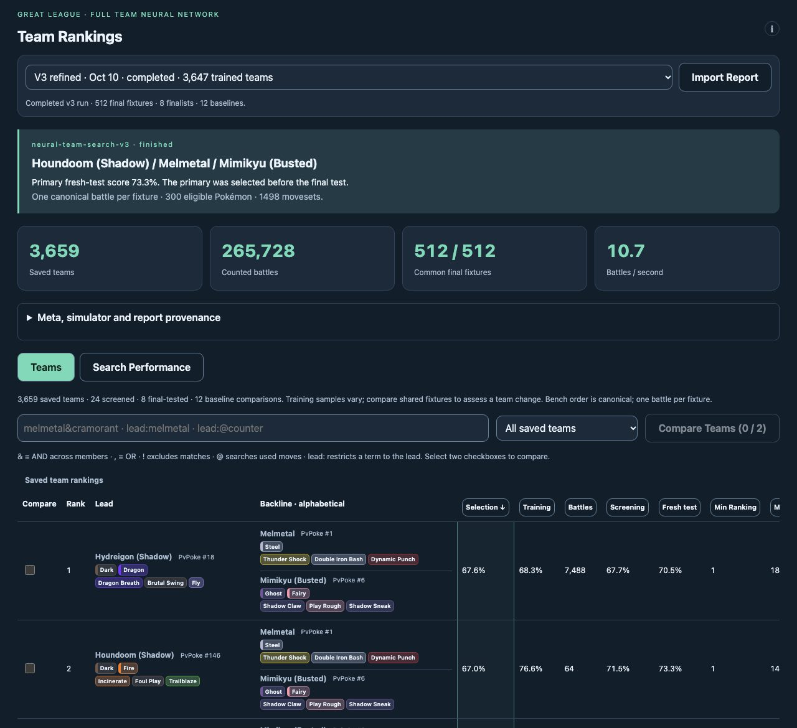

# Team Rankings — how it works, in plain language

Team Rankings looks for the strongest three-Pokémon teams for Great League, movesets included, by having a computer play tens of thousands of full 3-against-3 battles overnight. A small neural network learns from those battles which teams are worth trying next. At the end, the best candidates are tested again on opponents the search never saw, and the whole thing is shown in the **PvPoke Pro › Team Rankings** tab, where you can replay any saved battle.

This page is the short version. The [technical reference](README.md) has the formulas, the evidence for each design choice and the full list of limits.

## The problem

There are about 1.65 billion ways to pick a lead and two bench Pokémon from the 300 eligible entries with their five best movesets each. One battle takes a measurable fraction of a second, and one battle is only one noisy result: to know how good a team is, it has to play dozens of different opponents. So the search cannot try everything, and it cannot even properly test more than a few thousand teams in a night. It needs a fast guess about which teams are promising, a search that uses that guess without trusting it blindly, and a final exam that the search cannot have studied for.

## How it works, step by step

1. **Build the pool once.** The 300 Great League Pokémon that PvPoke expects to be met most often, each with every legal moveset tried one-on-one against 300 opponents in five shield situations (18 million quick fights). The five best movesets per Pokémon are kept.
2. **Decide who the opponents are.** Opponent teams are drawn from a mix: the teams actually seen in harvested YouTube battles (read by the [Meta Extractor](../../includes/meta/README-plain.md)), time-weighted so recent sets count more and capped so no single creator dominates, blended with PvPoke's own popularity estimates for the teams nobody has been seen using yet.
3. **Propose and predict.** Each round the search writes down 12,000 teams it has not tried: small changes to the current leaders (swap a moveset, change the lead, replace one member) plus brand-new random teams. The neural network scores all of them in about a second and a half.
4. **Simulate the chosen few.** 24 teams are picked: twelve the model likes best, six that look promising but uncertain, five at random so the search never stops exploring, and one re-test of a leader. All 24 play the same 8 opponent teams; the better half then plays 64. That is 864 full battles per round on 12 CPU cores. Both sides are played by a controller that only knows what a player would see on screen: the opponent's revealed Pokémon, their HP bar, shields and switch timer, and the moves it has actually used. Hidden backlines are imagined from the opponent meta.
5. **Learn.** The network is refitted on every battle so far (up to 48,000 of them), as twelve slightly different copies trained on resamples, so the search can tell where they agree and where they do not. About a fifth of the teams are kept out of training to measure how good the predictions really are.
6. **Exam time.** When 80% of the time budget is used, the 24 best teams play the same 512 new opponent teams; the best of those is named the primary team *before* the final test. Then the eight finalists and twelve simple baseline teams (random teams, popular Pokémon with their best moves, and greedy "cover every type" teams) play another 512 new opponents. Differences are judged on the same opponents, with intervals that say when two finalists cannot be told apart.

**A second exam when the first one is unclear.** If another team clearly beats the chosen primary on the final exam, picking it now would just be picking the best-looking of several noisy results. So the run plays the primary and that challenger again on a third, sealed set of opponents (256 by default), and the tab says whether the advantage held up, did not, or could not be tested in the time left. "Did not" is not proof they are equal: 256 opponents only reveal differences of about 5 points. The primary stays the primary either way. A team may also be required to have played a minimum number of battles (64 is recommended) before it can lead the search or be tested, and when time is left the final exam can keep growing, 64 opponents at a time.

## What the score means

A team's score is the share of battles it wins, with a draw counting as half, against opponent teams drawn from the modelled meta, with both sides played by the same computer controller. It is not a prediction of your win rate: real opponents have other movesets, other IVs and other habits, and the controller is simpler than a good player. What the score is good for is comparing teams under the same assumptions, and finding candidates worth trying.

## What the tab shows

- **Teams:** every team the search evaluated, with its training score (noisy, from the search itself), its screening score and its fresh-test score (the trustworthy ones). You can search teams the same way as the rankings, for example `melmetal&cramorant&@counter` or `lead:melmetal`.
- **Battles and replays:** click a team, then a battle, and the site replays it with the same engine and the same random seed, checks that it gets the saved result, and graphs all six Pokémon's HP.
- **Compare Teams:** two teams on the same opponents, with the difference, an interval, and which battles changed.
- **Search Performance:** how much better the model's picks were than random picks each round, how its prediction error fell, how the primary team did against the baselines, and, when a challenger needed a second exam, whether its advantage held up. When a run tested it, it also shows how each finalist scored against six opponent play styles (from never switching to never shielding), so you can see whether a score depends on one way of playing.
- **Import Report:** load the result of your own overnight run.

## How good is it

In the published run, the chosen team (Melmetal, Jumpluff, Shadow Quagsire) won 68.3% of its 512 final-test fixtures and beat the best simple baseline group by 17.6 points. The model's predictions for teams it had never seen were 77% closer to the truth than just guessing the average. Picks suggested by the model scored 59.5% against 36.6% for random picks in the last rounds. A later change to the way candidates are chosen gained a measured 18.8 points of pick quality on identical opponents.

Two cautions. First, scores from different versions of the simulator or different opponent metas cannot be compared with each other. Second, several finalists are often too close to separate: the tab says so rather than inventing a winner.

**How far to trust the model's own uncertainty.** The twelve networks never agree exactly, and how much they disagree about a team is one of the things used to pick which teams to test. Under the prediction-error chart in Search Performance, the tab now says how far that disagreement is from a real error bar. On the completed run you would have to stretch it about five times to contain the errors of nine in ten unseen teams, and it barely tells which predictions miss by more, because most of a team's measured error is luck in its own simulated battles rather than a flaw in the model. So the disagreement is a hint about what to test next, not a margin of error.

**How much does the score depend on the assumed opponents?** After the exams, each finalist is also played against several other plausible opponent mixes: popular Pokémon only, teams whose members cover each other's weaknesses only, only the teams seen in videos, the video teams without the biggest creator, and different popularity weightings. Under each finalist in Search Performance there is a line such as "across 6 metas: min 62.5%, spread 14.1 points", and a table shows every score. The spread is the gap between a team's best and worst score across those mixes: a small spread means the team does not hang on one guess about the opponents, a large one means it is tuned to one. The table also shows how big a spread luck alone would produce with that many battles (roughly 7 to 9 points at 128 battles per mix), because a spread no bigger than that cannot be told from luck. It is a way to read the result, not a way to choose the team: the primary team is still the one the screening picked.

**Do the opponents' moves matter?** By default every opponent plays PvPoke's recommended moves. A run can instead let the opponents seen in videos use the moves the Meta Extractor saw them use (about three quarters of the videos' Pokémon have a fast move read, under half a charged move, and only about 7% differ from the recommendation, so it is a small change), and can finish by replaying its finalists against each opponent Pokémon's next-best moves. The tab then says whether a finalist's score barely moves when the opponents carry something else, or drops. That is a stress test, not a prediction: it changes every opponent Pokémon at once.

## How fast is it

On a 12-core laptop the simulator plays about 16 full battles per second with the current controller; an eight-hour run completes roughly 300 search rounds and about 300,000 battles before the exams begin. Fitting the network takes about 20 seconds per round and scoring 12,000 candidates about 1.5 seconds, so nearly all the time goes to battles. The graphics card is not used: the battle engine is branching game logic, not matrix maths.

## How we know a change helped

Two overnight runs can differ by luck alone, so "the new score is higher" is not enough. Every comparison here puts all the teams on the same opponents, and a difference only counts when it is larger than the margin around it: with 512 opponent teams that margin is about 4 to 5 points, so smaller gaps are called ties. A change that only makes the program faster must give identical results. A change to the search is tested by running the old and new versions with the same budget and seeds, then putting both final teams, and the earlier winners, through one fresh set of opponents; every new run now also tests the earlier winners automatically as a fixed "previous champions" group. If the new search simply finds the old champion again, that is a tie, not a failure. A change to the assumptions themselves (the controller, the opponent meta, the simulator) makes scores before and after incomparable, so it is judged by how realistic it is, not by whether the score went up. The [full procedure](EVALUATION_PROTOCOL.md) has the details and the [technical reference](README.md#8-evaluation-protocol) the numbers.

## What it cannot do yet

- Promise the *best* team. It has looked at a few thousand of 1.65 billion teams; it finds strong teams under its assumptions.
- Know the real meta. The observed teams are a small, top-tier-player sample, and opponents run PvPoke's recommended movesets unless a run asks for the observed ones.
- Play like a strong human. The controller sees the right information now, but its switching, baiting and shielding are simple rules with a short lookahead.
- Try movesets outside the five scouted per Pokémon, or other IV builds.
- Prove that the game's rarer rules match the simulator's. Damage and move timing were checked against real battle footage (the middle half of 222 measured charged attacks landed within about 7% of the formula, with no bias), and the simulator's behaviour is now pinned so any change is noticed. But tie-breaks when both players throw a charged move at once, whether the Shadow bonus counts in them, the length of the switch cooldown and when stat changes land have not been checked against the game itself. A [findings note](findings/mechanics-fidelity.md) says how to check them.

The [technical reference](README.md#12-gaps-and-improvement-areas) lists what would address each of these, and what would make it faster.

## Running it yourself

From the `web` folder, with Node 20 or later: `node training/team-search/launch-next.cjs --hours 8` starts a detached run that keeps the Mac awake and stops by itself; `status.cjs` and `stop.cjs` check and stop it; the finished run's `report.pvpteams.json.gz` imports into the tab. Details are in the [technical reference](README.md#2-architecture).
