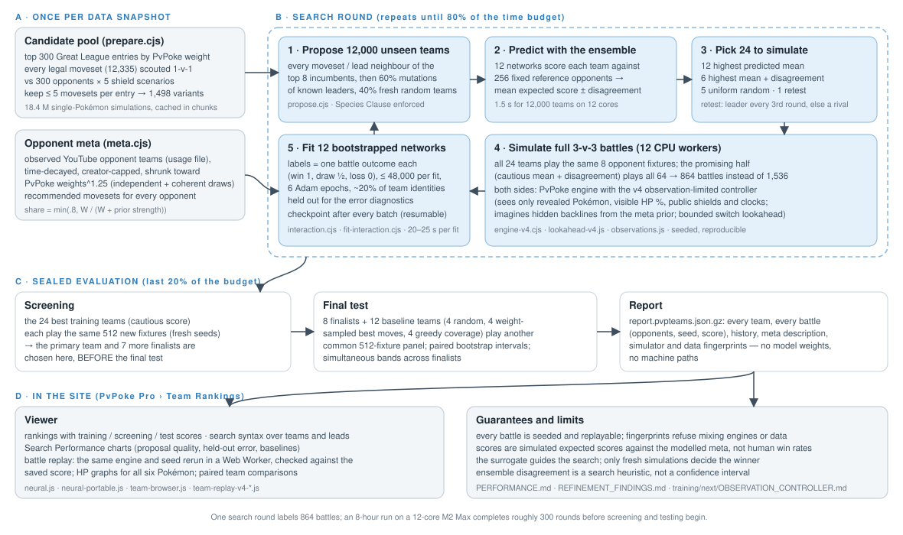
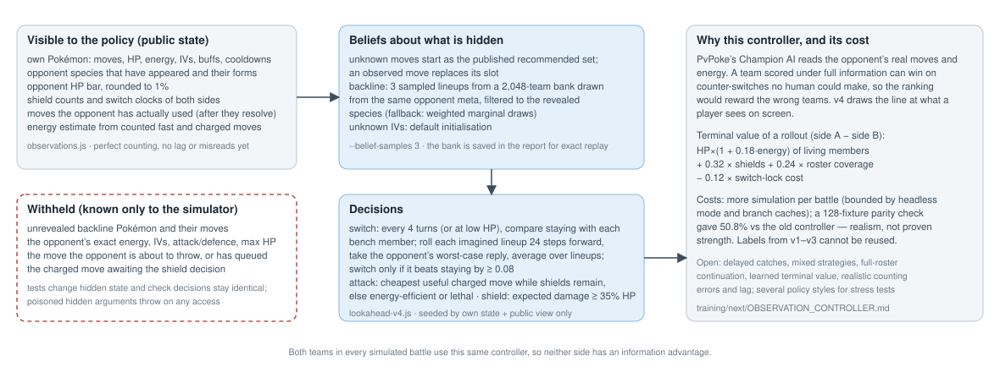
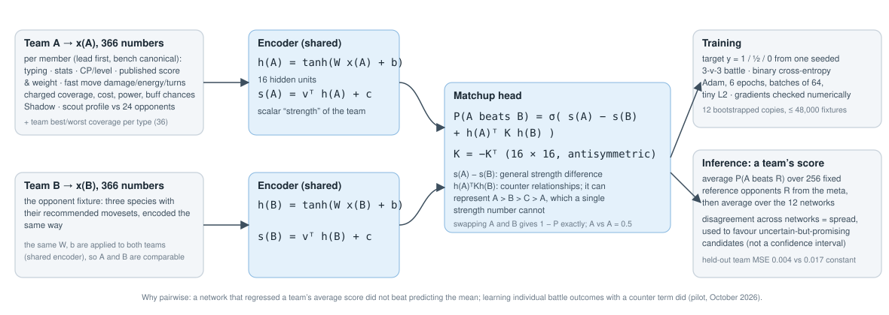

# Team Rankings — technical reference (full-team neural network)

Team Rankings searches for the strongest three-Pokémon Great League teams, with their movesets, against a modelled distribution of opponent teams. It simulates complete 3-v-3 battles with PvPoke's engine under an observation-limited controller, learns a neural matchup model from those outcomes to decide which teams are worth simulating next, and then tests its finalists on opponent panels that never touched the training. The site's **PvPoke Pro › Team Rankings** tab shows the result: every evaluated team, its scores at each stage, the search's learning curves, and a deterministic replay of any saved battle.

This is the technical reference and the run guide. A short plain-language summary is in [README-plain.md](README-plain.md). Detailed measurements live beside this file: [PERFORMANCE.md](PERFORMANCE.md) (simulator and fitting speed), [EVALUATION_PROTOCOL.md](EVALUATION_PROTOCOL.md) (how to tell an improvement from noise), [REFINEMENT_FINDINGS.md](REFINEMENT_FINDINGS.md) (acquisition benchmark), [PILOT_FINDINGS.md](PILOT_FINDINGS.md), [MODEL_AUDIT.md](MODEL_AUDIT.md), the controller's [information boundary](../next/OBSERVATION_CONTROLLER.md) and the [next-run audit](../next/NEXT_RUN_AUDIT.md). This revision describes the code as of 2026-10-12.

> **Status in one paragraph.** The published v1 run (October 9–10, 2026) selected Melmetal / Jumpluff / Shadow Quagsire, which scored 68.3% on 512 untouched opponent fixtures and beat the best simple baseline group by 17.6 points (paired interval 14.1–21.1). Its surrogate cut held-out team-prediction error by 77% against predicting the mean. Since then the controller was changed to see only what a player sees (v4), the search acquisition was improved by a measured 18.8 points of proposal quality, and the opponent meta can now be the teams observed in harvested YouTube battles. The first full v4 run against the observed meta (2026-10-12) selected Shadow Talonflame / Mandibuzz / Bastiodon at 83.5% on 512 untouched fixtures, with all seven other finalists inside the unresolved band. All scores are simulated expected scores under the modelled meta and controller, not human win rates, and scores under different metas are not comparable with each other (section 9).

## 1. Purpose, goals and design principles

### The problem

A team is three ordered Pokémon (the lead matters) from a pool of 300 eligible entries, each with up to five movesets: about 1.65 billion legal lead-plus-bench combinations. A single full 3-v-3 battle costs tens of milliseconds of branching JavaScript, and one battle is one noisy draw (win, draw or loss) against one opponent team, so a team's expected score needs dozens of battles before it means anything. Exhaustive search is impossible; so is evaluating more than a few thousand teams properly in a night. The system therefore needs a cheap model that predicts which teams are worth the expensive simulation, a search that uses it without being fooled by it, and an evaluation that cannot be contaminated by the search.

### Two goals, measured separately

| Goal | What is measured | How | Where |
| --- | --- | --- | --- |
| **Accuracy** | (a) the surrogate's prediction error on team identities it never fitted; (b) the selected team's score on opponent fixtures never used in training, against fixed baselines with paired intervals; (c) the realism of the target: opponent distribution and controller | held-out diagnostics every round; sealed screening and final panels with fresh seeds; counterfactual tests on the controller; stress tests across metas | sections 6, 8, 9 |
| **Speed** | battles per second across workers, seconds per neural fit and per 12,000-candidate inference, battles spent per training label, wall time to a trustworthy result within the budget | `benchmark-simulator-speed.cjs`, `benchmark-neural-speed.cjs`, run telemetry in `checkpoint.json` | section 10 |

### Design principles, and why

1. **Labels come only from simulation, and say so.** Every score is a seeded battle outcome under a pinned engine, data snapshot and controller. The report never presents them as player win rates. Changing the controller changes the labels, so old labels are never reused across controller versions (fingerprints enforce this).
2. **The surrogate guides, the simulator decides.** The neural model only chooses what to simulate next. Every number shown about a team is a simulated score; the model's forecast is shown separately as a forecast.
3. **Sealed evaluation.** Screening and final opponent panels use seeds generated by the launcher and reserved before the search starts; they never enter fitting or proposal. The primary team is chosen by screening *before* the final test, so the headline number is not the best of several looks.
4. **Paired comparisons, not raw averages.** Teams compared on the same opponent fixtures and seeds; intervals come from resampling whole fixtures, which keeps the correlation between a team's two orientations of one opponent.
5. **Determinism and replay.** Seeds, mechanics hash, data hash and algorithm hash are recorded; the browser reruns any saved battle with the same engine and verifies the saved score.
6. **CPU, not GPU.** The expensive work is a branching battle simulator, not a tensor workload; the small network trains in milliseconds. Twelve isolated worker processes with bounded heaps and regular recycling are the right tool.

## 2. Architecture



| Stage | Files | Notes |
| --- | --- | --- |
| Pool preparation | `prepare.cjs`, `prepare-worker.cjs` | exhaustive 1-v-1 scouting, cached in `pool.json.chunks` |
| Opponent meta | `meta.cjs`, `web/scripts/yt-harvest/usage_export.py`, `../next/usage-template.json` | synthetic priors and observed teams |
| Search loop | `search.cjs`, `propose.cjs`, `acquisition.cjs`, `budget.cjs`, `common.cjs` | detached by `launch.cjs` / `launch-next.cjs` |
| Neural model | `interaction.cjs`, `neural.cjs`, `fit-interaction.cjs`, `interaction-worker.cjs`, `predict.cjs`, `predict-worker.cjs` | plain JavaScript, no dependencies |
| Battle engine | `../engine-v4.cjs`, `../engine-v4-core.cjs`, `../next/lookahead-v4.js`, `../next/observations.js`, `../battle-worker-v4.cjs`, `../pool.cjs`, `../runner.cjs` | PvPoke vendor code pinned at commit `f627e89` |
| Evaluation | `evaluation.cjs` | screening, baselines, paired bootstraps |
| Reports | `report.cjs`, `export-report.cjs`, `evidence.cjs` | `report.html`, `report.pvpteams.json.gz` |
| Viewer | `web/includes/pro/neural.js`, `neural-portable.js`, `neural-report-core.js`, `team-browser.js`, `team-comparison.js`, `team-replay-v4-*.js` | import, rankings, charts, replay |
| Audits and tools | `audit-model.cjs`, `audit-exploration.cjs`, `benchmark-acquisition.cjs`, `absorb-evaluation.cjs`, `merge.cjs`, `remap.cjs`, `status.cjs`, `stop.cjs`, `rematch.cjs`, `compare-history.cjs`, `champions.cjs` | read-only diagnostics on frozen checkpoints and equal-footing comparisons of runs |

### Running a search

From the `web/` folder, with Node 20 or later and no npm packages:

```
node --test training/*.test.cjs training/next/*.test.cjs training/team-search/*.test.cjs
node training/team-search/prepare.cjs --shortlist 10000 --scout-opponents 300 --workers 12   # once; or copy an existing pool.json
node training/team-search/launch-next.cjs --hours 8                                           # detached, caffeinated, all cores
node training/team-search/status.cjs training/runs/team-search-v4
node training/team-search/stop.cjs training/runs/team-search-v4                               # drains active battles, then saves
```

With the observed meta (the exporter prints the as-of date and the prior strength that make observed teams 75% of the opponents):

```
python3 -I scripts/yt-harvest/usage_export.py
node training/team-search/launch-next.cjs --hours 8 --out training/runs/team-search-v4-observed-YYYY-MM-DD \
  --usage-file "$HOME/Desktop/Projects/PoGo Recorder/src/yt-harvest/usage/observed-gl-opponents.json" \
  --usage-half-life-days 30 --usage-as-of YYYY-MM-DD --usage-prior-strength N
```

When the run finishes, import `training/runs/<run>/report.pvpteams.json.gz` in PvPoke Pro › Team Rankings. Runs stay local in `training/runs/`, which git ignores.

`launch-next.cjs` also tests the earlier winners: the published v1 and v3 primaries and the primary of every completed run with the same pool hash (final panel of at least 256 fixtures) join the final panel as the fixed `previous-champions` baseline group. `--champions FILE[,FILE…]` replaces that list, `--champions none` disables it, and `--champions-scope finalists` takes every final-tested team of each source (section 8, [EVALUATION_PROTOCOL.md](EVALUATION_PROTOCOL.md)).

## 3. The search space: eligible Pokémon and movesets

1. **Population.** The published Great League rankings with PvPoke's default matchup weights; entries sorted by weight (ties by rank), the top 300 with positive weight kept. Shadow and regional forms are separate entries; a team cannot contain two entries with the same Pokédex number (Species Clause). The current pool has 215 distinct Pokédex numbers, no unreleased or Mega entries, and total weight 964. *Why weight rather than rank:* weight is PvPoke's estimate of how often an entry is met, so the pool covers what teams must beat as well as what might be strong.
2. **Movesets.** Every legal fast/charged combination from the engine's own pools, including allowed special moves: 12,335 combinations. Each is scouted 1-v-1 against the 300 recommended-moveset opponents (excluding its own species) across the five published shield/energy scenarios: 18,440,825 single-Pokémon simulations, run in chunks of 16 movesets with a 120-second watchdog and atomic cache files, so preparation restarts from completed chunks.
3. **Retention.** Combinations are ranked by weighted mean raw battle rating and the top five kept: 1,498 variants (299 species have five, one has three). Recommended movesets land in the top five for 290 species but are not forced in. *Why five:* the candidate space is already 1.65 billion teams with five variants; more variants multiply it without changing the fact that only a few thousand teams can be simulated. *The cost:* retention is by 1-v-1 performance, so a moveset that is only good in a particular team context can be excluded (section 12).
4. **Features for the model** are computed once per variant at this stage: the scout profile against the first 24 scouted opponents and the best/worst coverage per type.

A cheaper approximate mode (`--shortlist 64 --scout-opponents 24`) projects type-aware cycle damage first and simulates only the shortlist; the overnight runs use the exhaustive pool.

## 4. The opponent meta

The search finds a best response to whatever opponents it is given, so the opponent distribution is the largest single assumption in the system. `meta.cjs` builds it from up to three components (`--meta hybrid`, the default):

- **Independent draws** from PvPoke weights raised to the power 1.25. The weight-1 floor gave 220 fringe entries 22.8% of all first-slot draws; the exponent lowers that to 13.1%. This is a popularity prior, not usage.
- **Coherent draws**, half of the synthetic share: after a weighted lead, each next member is drawn with probability proportional to weight × exp(3 × coverage improvement over the team so far), and in 40% of these teams the backline prefers a shared type that differs from the lead's (an ABB shape, multipliers 2.5 and 0.6). These are plausible patterns, not measured cores.
- **Observed teams** from the YouTube harvest (`--usage-file`). `usage_export.py` writes the opponents' complete Great League teams: open Great League and Mega Edition only; no Team Rocket, championship, no-footage or obscured videos; complete teams only, every member mapped into the pool; Shadow only when a reviewer or the Shadow classifier's held-out gate confirmed it; dated by recording date, else upload date; split and re-uploaded battles removed; each channel's rows weighted min(1, K/n) so no channel holds more than 10% of the weight. Observations decay with `--usage-half-life-days` from `--usage-as-of`, and the effective sample size is the Kish estimate (sum w)² / sum w². The observed share is `min(0.8, W / (W + prior strength))`, where W is the decayed, weighted total: a large stale archive must not dominate current play, and sparse observations are shrunk toward the prior. Opponents always use published recommended movesets; observed moves are not inferred as fact.

The first export (2026-10-11) gave 190 opponent teams (181 distinct) from 46 videos by 18 creators, dated 2026-09-20 to 2026-10-11; of 965 battles at 1,500 CP, 20% were eligible (52% were restricted cups, 17% partial teams, 6% unmapped species, mostly Megas). Known biases: these are top-tier players' opponents; 43% of members had an unknown Shadow status and count as the base form; most teams were seen once. The run's `meta.description` records source, hash, share, distinct teams, creators and date range, and the report shows them.

A separate, independently generated 2,048-lineup bank from the same meta serves as the controller's belief prior over hidden backlines (section 5); it contains only public prior data, never the actual fixture.

## 5. The battle simulator and controller



### Engine

Every battle runs PvPoke's own `Battle.step` state machine (vendor files pinned at commit `f627e89`, MIT) inside a fresh VM context per encounter, with a virtual scheduler that advances timers without waiting for animations. Headless mode skips animation objects and detailed timeline events while keeping the compact charged events the switch clock needs; traced replays reconstruct the full timeline. Caches of type tables, move metadata and public stat templates are bounded or weakly referenced and never hold hidden live opponent state. The optimised path was verified against the baseline on every outcome, turn count, remaining Pokémon, charged count and planner statistic across 1,536 battles, with frozen pre-optimisation reference tests comparing public observations, every HP sample and every traced event. It is 1.33× faster (12.24 → 16.25 battles/s on 12 workers for the benchmark fixture).

### Side and bench invariance (v2)

The lead is meaningful; the two bench members are canonicalised by identity for the simulator, deduplication and the model's features. Physical player slots are assigned from team identity and a seeded coin so that lexical identity never gets a privileged slot; equal-attack charged-move ties use a seeded identity-based break; both players have equal base priority; one canonical battle per fixture supplies one label (no redundant mirrored simulation). Identical teams on both sides are recorded as the expectation 0.5 of the seeded battle and its mirror.

### The observation-limited controller (v4)

PvPoke's Champion AI reads the opponent's real moves and energy. A team scored under full information can win on counter-switches no human could make, so a full-information ranking rewards the wrong teams. v4 draws the line at what a player sees:

- **Visible:** own roster and resources; opponent species that have appeared and their forms; the opponent HP bar rounded to 1%; public shield counts and switch clocks; moves the opponent has actually used, recorded after they resolve (a shielded charged move is revealed, but not to the shield decision it was shielded by); an energy estimate from counted fast and charged moves.
- **Withheld:** unrevealed backline Pokémon and their moves; the opponent's exact energy, IVs, stats and maximum HP; queued actions; the charged move awaiting a shield decision. Tests change hidden state and verify that decisions and observation records stay identical; poisoned hidden arguments throw on any property access.
- **Beliefs:** unknown moves start as the published recommended set and are overridden by observed moves; hidden backlines are three sampled lineups from the 2,048-team bank filtered to the revealed species (falling back to weighted marginal draws, which loses joint correlations); unknown IVs use default initialisation.
- **Decisions:** switching compares staying with each living bench member every four turns (sooner at low HP or when forced), rolling each imagined lineup 24 simulator steps forward against the opponent's legal replies, taking the worst-case reply per lineup and averaging over lineups; a voluntary switch needs an improvement of at least 0.08. The terminal value is remaining HP × (1 + 0.18 × energy/100) of living members, plus 0.32 per shield, plus 0.24 × a roster-coverage term (damage-per-energy pressure of survivors against the remaining opposing roster through type effectiveness and current stats), minus 0.12 × switch-lock cost. Attack choice prefers cheaper charged moves while the opponent has shields, avoids charged overkill when a fast move finishes, and otherwise favours energy-efficient or lethal moves against the predicted opponent; the shield decision averages the predicted damage of affordable opposing charged moves and shields when it reaches 35% of HP or is lethal.

*What this does and does not establish.* v4 is a realism correction, not a proven strength increase: a 128-fixture parity check between the lookahead and the original controller gave 50.8% (interval 45.2–56.3%). Both teams in every battle use the same controller, so neither side has an information advantage. Labels from v1–v3 cannot warm-start v4. Still open: delayed catches, mixed strategies, full-roster continuation rollouts, a learned terminal value, realistic counting errors and lag, and several policy styles for stress tests.

### Fingerprints

`mechanicsHash` digests the vendor engine, the training adapters and the controller sources; only exact, parity-verified implementation snapshots share a historical mechanics id (`simulator-compatibility.json`). `dataHash` digests the rankings, overrides and game master. `algorithmHash` digests the search code. A checkpoint resumes only under identical config, pool and algorithm; a warm start requires the same mechanics and meta and fresh evaluation seeds. Reports carry all three hashes, and the browser refuses to replay a report whose hashes do not match its adapter.

## 6. The neural matchup model



### Features

A team's input `x(T)` has 366 numbers: for each of the three members (lead first, bench in canonical order) the variant's features from scouting (typing, real Great League stats, CP and level, published score and default weight, fast-move type, damage per turn, energy per turn and duration, charged-move coverage, costs, power and proc chances, Shadow status, the scout profile against 24 opponents) plus 13 move-effect numbers (expected self and opponent attack/defence stage changes weighted by proc chance, and the Shadow flag), and then 36 team-level numbers: the best and worst scout coverage per defending type across the three members. Explicit coverage summaries help a small network learn synergy from few, expensive labels. Opponent fixtures are encoded the same way from their recommended movesets.

### Architecture

```
h(T) = tanh(W x(T) + b)            16 hidden units, shared encoder
s(T) = vᵀ h(T) + c                 scalar strength
P(A beats B) = σ( s(A) − s(B) + h(A)ᵀ K h(B) ),   K = −Kᵀ
```

The scalar term learns general strength; the antisymmetric interaction matrix learns counter relationships (A beats B, B beats C, C beats A), which a single strength number cannot represent. Swapping the teams gives exactly 1 − P, and identical inputs give 0.5. The model predicts expected matchup reward; a draw counts as half a win.

*Why pairwise.* The first model regressed a team's average score and did not beat a constant predictor. Learning individual matchup outcomes helped; adding the learned antisymmetric matrix improved held-out matchup error by a further 11–13% in the pilot. A cyclic-counter fixture confirms the model learns a relationship a scalar model cannot.

### Training

Binary cross-entropy on fractional targets (1, ½, 0) with Adam (rate 0.002, batches of 64, 6 epochs, tiny L2: 0.0001 on weights, 0.001 on K); gradients are checked numerically, including the constrained interaction parameters. Twelve independently initialised networks form the ensemble. Each fit samples at most 48,000 distinct labelled fixtures *without replacement* from the training set, then each member bootstraps that subset once. About 20% of candidate team identities (by hash) are excluded from every fit and serve as the held-out diagnostic set; screening and final fixtures never enter fitting.

Measured choices (three-seed comparisons on the pilot's 56,640 fixtures): six epochs instead of ten reduced held-out team-average error by 9.2% (per-fixture error slightly worse; team selection uses team averages, so six is the default); raising the fixture cap from 12,000 to 48,000 reduced it by 30.1%; sampling without replacement before bootstrapping reduced it by another 12.0% at a 24,000 cap; a whole-team bootstrap (resampling complete candidate blocks) worsened two of three folds by 12–14% and was not adopted; aligning buff features to charge-energy order made no difference; per-charged-move type indicators worsened error (0.0063 vs 0.0050) and were dropped.

### Inference and uncertainty

A team's estimated score is its mean P(A beats R) over 256 reference opponents R drawn once from the meta, averaged over the ensemble. Twelve workers score 12,000 candidates in about 1.5 s (8.4 s single-threaded), preserving every prediction exactly. The spread across the ensemble is used as a search heuristic for promising-but-uncertain candidates; it is **not** a calibrated confidence interval, because the members share training data and fixtures are correlated across candidates.

### Diagnostics

Every round records, on the held-out identities: per-fixture MSE of the neural prediction versus the constant mean, and team-mean MSE versus the constant mean. In the published v1 run the final values were 0.0041 versus 0.0173 (76.6% lower) for teams and 0.118 versus 0.163 for fixtures. Team RMSE of about 6.4 points is still larger than a small moveset difference, which is why the search retests contenders and the report refuses to call close finalists apart.

## 7. Search and acquisition

Each round (`search.cjs`, `propose.cjs`, `acquisition.cjs`):

1. **Generate 12,000 unseen candidates.** First every unseen single-member moveset substitution and both alternative leads around the eight highest-ranked incumbents (an exhaustive local neighbourhood of the retained variants, not of all moves); then, until the pool is full, 60% mutations of known leaders (35% swap a member's moveset, 20% change the lead, else replace a member) and 40% fresh random teams. Species Clause is enforced throughout and every team is canonicalised.
2. **Predict** all candidates with the ensemble.
3. **Select 24:** half the slots by highest predicted mean (`neural`), a quarter by highest mean + ensemble standard deviation (`uncertainty`, the "promising exploration" rule), a quarter uniform random teams independent of the proposal shortlist (`random`), and one retest: the incumbent every third round, otherwise one of the next seven contenders, or a moveset rival of a selected team on identical opponents.
4. **Simulate in two stages.** All 24 play the same 8 opponent fixtures; a deterministic optimistic score (mean shrunk toward 0.5 with 8 pseudo-fixtures, plus 1.28 posterior standard deviations, plus the ensemble spread) promotes the top half to the full 64 fixtures. That is 24×8 + 12×56 = 864 battles instead of 1,536, 43.75% fewer, so about 1.78× as many candidate starts per battle budget. The cost is that a strong team can be discarded after a noisy prefix (`--promotion-fraction 1` restores full allocation). Fixtures are dispatched common-prefix first, so comparisons keep matched observations if the process stops early; each result commits independently and the checkpoint is resumable.
5. **Refit** the ensemble, record the round's proposal-quality diagnostics (mean score of each source on the shared 8-fixture prefix) and held-out errors, checkpoint, and loop.

**Training leaders** are ranked by a cautious selection score: shrink the fixture mean toward 0.5 with eight pseudo-fixtures, then subtract 1.28 posterior standard deviations. It reduces the chance that a lucky small sample leads, but it is a heuristic, not a confidence bound, and does not remove multiple-comparison optimism.

**Budget.** Proposals stop at 80% of the wall-clock budget, or earlier once measured throughput shows that screening, final testing and baselines need more time (estimated after 512 battles with a 25% margin). Duration-based runs exclude event-loop suspension gaps over 30 s (a sleeping laptop) and the battle watchdog allows 120 awake seconds.

**Evidence for the acquisition rule.** In the completed v3 run, pure-disagreement exploration proposals averaged 37.4% over 154 rounds, barely above random (34.0%), while neural exploitation proposals averaged 60.5%. A retrospective diagnostic on 757 held-out identities gave 32.9% for disagreement alone versus 60.0% for mean + disagreement. A fresh paired benchmark with the frozen model on 12,000 unseen candidates and a new 128-opponent panel (1,536 battles) gave 35.4% versus 54.2%: **+18.8 points, paired interval 13.6–24.1**. The local neighbourhoods and rotating retests passed regression tests but their independent contribution to final team quality has not been measured.

## 8. Evaluation protocol

1. **Screening.** The 24 best training teams by selection score each play the same 512 fresh opponent fixtures (a seed derived from the launcher's validation seed, checked against any absorbed evidence). Fixture-major scheduling keeps every contender on the same completed prefix if the deadline expires. The primary team and up to seven more finalists are chosen here.
2. **Final test.** The finalists and twelve fixed baseline teams (four uniform-random, four weight-sampled with each member's best scouted moveset, four greedy coverage teams built from scout ratings with different weak-link penalties and bounded coordinate swaps, all fixed before the test) play another common 512-fixture panel under a fresh seed. Each team's score is its mean over the panel.
3. **Comparisons.** The primary versus each baseline group uses a paired bootstrap over whole opponent fixtures (5,000 resamples, 95% interval), conditional on those baseline teams and the pinned simulator. The primary versus each other finalist uses a simultaneous paired bootstrap whose band accounts for comparing several finalists at once; a finalist is "unresolved" when its band crosses zero. The screening-selected primary stays the primary even if another finalist's final point estimate is higher.
4. **Reuse without contamination.** `absorb-evaluation.cjs` converts a finished run's screening, final and baseline battles into training evidence for a *new* run, marks their seeds as used, and the launcher then draws a fresh validation seed that must not collide. `merge.cjs` and `remap.cjs` combine or translate raw fixture observations only across identical pools and mechanics.

**Telling an improvement from noise.** Whether a change helped depends on its class, and the sealed final panel only answers part of the question. A pure speed or refactor change must reproduce byte-identical outcomes (same seeds, a fixed `--rounds`) and is then measured for throughput. A search, acquisition or model change under the same pool, meta, controller and seeds is judged by an equal-budget A/B: the two primaries are re-simulated together on one fresh panel with `rematch.cjs` (paired bootstraps, simultaneous bands over all pairs), alongside the `previous-champions` baseline group and matched-battle history curves from `compare-history.cjs`. The group is the earlier winners (the published v1 and v3 primaries and every completed run with the same pool hash, added automatically by `launch-next.cjs`; `--champions FILE[,FILE…]` elsewhere), re-simulated on the run's own sealed final panel, so each comparison is paired and unbiased. A rediscovered champion, or any difference inside the interval (about 4 points for one comparison and 5 for several at 512 fixtures), is a tie, not a failure. A simulator, controller or meta change relabels everything: scores are comparable only under the new assumptions, so the old champions are re-simulated there and the change itself is judged by realism metrics (mechanics-fidelity fixtures, and the report fields `policyPanel` and `sensitivity` that are being added; they are not in reports yet), never by a higher score. Including the previous victors is enough only when simulator, meta and pool are unchanged and they are compared with the new primary on the same sealed panel. See [EVALUATION_PROTOCOL.md](EVALUATION_PROTOCOL.md) for the decision procedure and the statistical fine print.

## 9. Results so far

Scores from different controllers or metas are not comparable with each other: each row is conditional on its own simulator version and opponent distribution.

| Run | Controller / meta | Primary team (lead first) | Final score | Against baselines | Surrogate | Compute |
| --- | --- | --- | --- | --- | --- | --- |
| Pilot (2026-10-09) | v1 full information, independent weights | Melmetal / Jellicent / Umbreon | 62.1% over 512 mirrored battles | +27.8 vs random (22.3–33.3), +22.6 vs weight-sampled (16.1–29.0) | per-fixture MSE 0.135 vs 0.156, team 0.0054 vs 0.0079 | 56,640 battles, 411 teams |
| Stronger pilot comparison | v1 | Melmetal / Cramorant / Jumpluff | 62.7% | +31.5 random, +12.3 weight-sampled, +14.0 coverage | | |
| **Published v1 run** (2026-10-10, the site's default archive) | v1 | Melmetal / Jumpluff / Shadow Quagsire | **68.3%** on 512 fixtures (1,024 battles; SE 1.6) | +17.6 vs coverage (14.1–21.1), +19.4 weight-sampled, +35.7 random | team MSE 0.0041 vs 0.0173; neural proposals 59.5% vs random 36.6% in the last rounds | 517,004 battles incl. inherited evidence, 374,540 new at 22.7/s, 3,453 teams, 11.6 cores busy |
| v3 refined (2026-10-10) | v3 bounded lookahead, hybrid synthetic meta | Shadow Houndoom / Melmetal / Mimikyu | 73.3% on 512 fixtures | all 24 screened and 8 finalists completed; several finalist differences unresolved | | 265,728 battles, 3,647 teams |
| **v4 observed** (2026-10-12, 6.6 h) | v4 observation-limited; 75% observed YouTube teams (540 teams, 489 distinct, 109 videos, 35 creators; half-life 30 days, prior strength 155) | Talonflame (Shadow) / Mandibuzz / Bastiodon | **83.5%** on 512 fixtures (one battle each) | +44.0 vs coverage (39.9–47.9), +35.5 weight-sampled (31.6–39.3), +49.0 random (45.2–52.7); all seven finalist comparisons unresolved | team MSE 0.0210 vs 0.0598 constant (held-out mean 0.59) | 340,183 battles at 14.4/s, 363 rounds, 8,477 teams; 7.3 cores busy on average (the machine was shared in the last hours) |

Lessons recorded from these runs:

- **Scores under the observed meta are not comparable with the synthetic-meta runs.** 83.5% against a target that is 75% observed teams (489 distinct) versus 68.3% against the broad synthetic prior says that the observed target is narrower and easier to best-respond to, not that the team is stronger; the four baseline groups also moved. The meta-sensitivity panel (section 12) is the tool for reading such a number: the same finalists re-scored under several metas, with the spread shown.

- **All eight v1 finalists led Melmetal.** That may be strength under the chosen population and controller, but concentration is a reason to test sensitivity to the meta and policy, not to assume the human meta is solved.
- **The Cramorant moveset claim did not survive a paired test.** Hydro Pump/Surf's 75.0% training score had 128 games against Dive/Fly's 65.8% over 1,792, on different fixtures. On a shared 512-fixture screening panel they scored 63.5% and 64.6% (paired difference about −1.1, interval −4.4 to +2.2). A listed move is not evidence that it caused the wins; replays showed Hydro Pump never fired in several of them.
- **Fresh screening is necessary.** Some training leaders dropped sharply on new opponents, which is why screening precedes the final test and the primary is chosen before it.

## 10. Speed and compute

| What | Measurement | Where |
| --- | --- | --- |
| Full-battle throughput, 12 workers (v4, 24-turn forecasts, 3 belief worlds) | 16.25 battles/s optimised vs 12.24 baseline (1.33×), 192 battles | [PERFORMANCE.md](PERFORMANCE.md) |
| v1 overnight throughput | 22.7 battles/s with 11.56 cores busy (cheaper controller) | [NEXT_RUN_AUDIT.md](../next/NEXT_RUN_AUDIT.md) |
| Neural fit (366 inputs, 16 hidden, 4,096 fixtures, 3 epochs) | 382 → 293 ms (1.30×) by caching repeated feature vectors' activations within a minibatch and reusing buffers; serialized models byte-identical | PERFORMANCE.md |
| Full ensemble fit in a run (48,000 fixtures, 12 models on 12 workers) | about 19–25 s per round | run telemetry |
| Candidate inference, 12,000 teams × 256 references × 12 models | 8.4 s → 1.5 s on 12 cores, predictions identical | PILOT_FINDINGS.md |
| Battles per round | 864 instead of 1,536 (staged acquisition) | section 7 |
| Pool preparation | 18.4 M 1-v-1 simulations, chunked and cached | section 3 |
| Memory | workers recycled every 8 battles (or at heap pressure) with 128–192 MB old-space limits; peak sampled RSS 1.4–5.5 GB for the process tree | PERFORMANCE.md, run telemetry |

**Where the time goes.** A profile of the simulator attributed about 15% to type-effectiveness tables, 6% each to move creation, Pokémon construction, garbage collection and move resetting, 4% to move initialisation and 5% to damage; the dominant cost in v4 is repeated forecast preparation, since every switching decision creates duels and prepares six Pokémon per imagined lineup. The implemented fixes share immutable ordered type tables, cache normalised move metadata and public stat templates, prepare only selected attacks for forecast Pokémon, reuse damage-only opponent guesses within a turn and identical branches across both controllers (branch cache), and run forecasts headlessly.

**Measured and rejected:** longer worker lifetimes (8 vs 24 or 32 battles: no gain, more memory); caching compiled simulator scripts across contexts (no gain); larger heaps; transporting the public prior once per worker; flattened inference reference data (slower than reusable scratch buffers); fewer forecast worlds or shorter horizons (they change decisions, so they are not transparent optimisations). The GPU and Neural Engine are not used: the branching simulator is not a tensor workload and the network is tiny.

## 11. The viewer

The Team Rankings tab loads the published v1 archive by default and can import any `report.pvpteams.json.gz` (data only; the report never carries executable code). It shows:

- **Teams:** every evaluated team with training score, cautious selection score, screening score and fresh-test score; 500 per page; search with the rankings syntax where each AND term may match a different member (`melmetal&cramorant&@counter`), `lead:` scopes a predicate to the lead, negation excludes teams; Lead and alphabetical Backline columns; Min, Max and Average published rank; an Alternate Moveset badge against the published recommendation.
- **Battles:** each team's paired battle list by stage; clicking a fixture reruns both orientations in a Web Worker with the report's engine version, seed, controller and belief priors, verifies the replay against the stored score, and graphs all six Pokémon's HP with attack, shield, switch and faint markers. Replay is allowed only when the report's mechanics and data hashes match the installed adapter.
- **Team Comparison:** two teams on their freshest common stage: paired score deltas, an approximate 95% interval, changed outcomes, conditional opponent associations, side-by-side replays, and an optional matched exploratory panel of up to 512 fixtures. Comparison replays list the charged attacks actually used and flag changed moves that never fired.
- **Search Performance:** proposal quality (trailing means of neural, random and uncertainty picks), the training leader's raw score, held-out MSE against the constant baseline, simulation progress, the final baseline comparison (with the previous-champions group and a champion-by-champion table when the run had one), finalist cards and the opponent-meta line ("Opponent meta: 75% observed teams, 25% PvPoke prior · 190 teams (181 distinct) from 18 creators …").

The report contract (`format: "pvp-team-report"`, schema 1, engine versions v1–v4) is documented in [NEURAL_REPORTS.md](../../includes/pro/NEURAL_REPORTS.md).

## 12. Gaps and improvement areas

### Accuracy (how much the result can be trusted)

| Gap | Evidence | What would close it |
| --- | --- | --- |
| **The target distribution** | the optimiser finds a best response to its opponents; the synthetic prior's weight-1 tail and hand-designed cores are assumptions; the first observed export has 190 teams from 18 creators and 43% of members with unknown Shadow status | more harvested battles and answered Shadow questions; stratify by rating and date; evaluate finalists across several plausible metas and report the spread, not one number |
| **The controller** | bounded minimax switching with a heuristic terminal value, simple attack and shield rules, perfect counting; a 128-fixture check shows parity with the old controller, not strength | full-roster continuation rollouts, delayed catches, response-probability-weighted (not worst-case) replies under beliefs, a learned terminal value; evaluate against held-out stronger and diverse policies; model counting errors and lag |
| **Opponent movesets** | opponents always run recommended movesets; alternate-move counters and bait patterns are absent | observed moveset frequencies from the Meta Extractor's fast-move and charged-move records; bounded alternate-moveset stress panels |
| **Retained movesets and IVs** | five 1-v-1-scouted movesets per entry; default IV builds; a team-specific moveset can be excluded | targeted moveset mutation outside the five with 3-v-3 retention; alternate IV builds for the finalists |
| **Surrogate error and calibration** | team RMSE about 6 points; ensemble spread is not an interval; held-out identities come from the same search and meta | candidate, opponent, policy and meta holdouts; proper uncertainty needs both grouping dimensions and independent simulation |
| **Selection and multiple comparisons** | eight finalists with overlapping bands; the primary is pre-selected, but the best-looking final score is still optimistic | a new sealed test for any newly selected winner; larger common finalist panels; minimum sample thresholds before a contender can lead |
| **Telling a real improvement from noise** | a run's own final score is conditional on its panel and assumptions (the v1 primary's 68.3% became 42.2% on the observed meta under the v4 controller in an exploratory 64-fixture rematch); one run per arm gives no estimate of search-to-search variance; at 512 fixtures differences under about 4 to 5 points are unresolved | the tools now exist: `previous-champions`, `rematch.cjs`, `compare-history.cjs` and [EVALUATION_PROTOCOL.md](EVALUATION_PROTOCOL.md). Still open: replicated seeds per arm, time-to-champion (history records scores, not team identity), 1,024 or more fixtures for sub-3-point claims, and the realism metrics (`policyPanel`, `sensitivity`) for assumption changes |
| **Mechanics fidelity** | PvPoke's emulator approximations (CMP ties, buff chances, switch and catch timing) are inherited; canonical routing removes caller-order artefacts, not game differences | dedicated parity fixtures against the game's training mode; keep the mechanics hash honest |
| **Coverage of the space** | 3,215 canonical identities seen in 3,453 records, 0.00019% of the pool | this is inherent; the honest claim is "a strong team under these assumptions", never "the optimal team" |

### Speed (how much search fits in a budget)

| Gap | Evidence | What would close it |
| --- | --- | --- |
| **Forecast preparation dominates** | every switch decision builds duels for every imagined lineup; branch caching and headless mode recovered 1.33× | pool forecast state; an array-based combat state instead of Pokémon objects (a larger rewrite needing full timing and form parity) |
| **Battles per label** | 864 per round after staged acquisition | adaptive prefix length by observed variance; share fixtures across rounds for retests |
| **Fitting and inference are already small** | 20–25 s per fit, 1.5 s per inference round against hours of simulation | no action needed until the simulator is several times faster |
| **Pool preparation** | 18.4 M simulations, cached | unchanged data snapshot reuses the pool; a new snapshot pays once |

## 13. Reproducibility and files

Within a run directory: `pool.json` (population, variants, stats, scouting settings, input and pool hashes), `checkpoint.json` (raw fixture labels, models, pending round, diagnostics, screening, final and baseline results, telemetry; atomic after every batch), `history.jsonl` (round summaries), `models.json`, `recommendations.json`, `opponent-analysis.json` (every primary final fixture with opponent movesets and seeds), `report.html` / `findings.md`, `report.pvpteams.json.gz`, `training.log`, `launch.json` and `process.json` (verified process identity, start and end, deadline).

Compatibility rules: resume requires the original algorithm code, settings and pool (worker count and hours may change; ensemble size and seeds are fixed); warm start requires the same mechanics and meta and fresh evaluation seeds; v1–v3 labels never warm-start v4 (`--seed-teams OLD_CHECKPOINT` passes compositions as initial hints only, re-simulated); historical reports keep their original mechanics ids and replay with their own adapters.

```
node training/team-search/audit-model.cjs --checkpoint CHECKPOINT.json --pool POOL.json --fold 0 --cap 24000 --ensemble 4 --epochs 6 --repeats 3 --out model-audit.json
node training/team-search/audit-exploration.cjs --checkpoint FILE --pool FILE --out FILE
node training/team-search/benchmark-acquisition.cjs --checkpoint FILE --pool FILE --out FILE
node training/benchmark-simulator-speed.cjs 192 3 12 training/simulator-speed-results.json
node training/team-search/benchmark-neural-speed.cjs
node training/team-search/export-report.cjs training/runs/<run>
node training/next/controller-check.cjs 128
node training/team-search/rematch.cjs RUN_A RUN_B [--finalists] --fixtures 512 --workers 12 --meta hybrid --out training/runs/rematch.json   # equal-footing re-simulation of primaries or finalists
node training/team-search/rematch.cjs --print training/runs/rematch.json
node training/team-search/compare-history.cjs RUN_A RUN_B --labels old,new --json training/runs/history-comparison.json                    # matched-battle history comparison
node training/team-search/search.cjs ... --champions includes/pro/data/team-search.json,includes/pro/data/team-v3-refined.pvpteams.json.gz,training/runs/RUN   # previous champions as a baseline group
```

`rematch.cjs` takes run directories, `recommendations.json`, portable reports or the v1 archive, maps each composition into the pool, draws a fresh panel (refusing a seed a source used), and prints every pair under one simultaneous band; `--finalists` adds all final-tested teams. `compare-history.cjs` reads two `history.jsonl` files at equal cumulative battles and reports neural-proposal quality, held-out team error against the constant predictor, best training score, teams labelled and battles per labelled team, each as improvement, no difference or regression. With `--champions`, the checkpoint, `recommendations.json` (`champions`, `championComparisons`), `report.html`, `findings.md` and the portable report carry the `previous-champions` group, and a resumed run keeps the champions its checkpoint registered; without the flag every output is unchanged.

## 14. History

| Version | Date | Change |
| --- | --- | --- |
| Strategy tuner | 2026-10-08 | five Champion preference multipliers tuned by evolution over seeded 3-v-3 fixtures; no dependable improvement, kept as `train.cjs` |
| v1 | 2026-10-09 | neural team search: pairwise interaction network, exhaustive scouting pool, screening and final tests, published report with replay |
| v2 | 2026-10-10 | identity-based side routing, canonical bench, one canonical battle per fixture, bounded switch lookahead, hybrid meta with coherent prior, observed-team import |
| v3 | 2026-10-10 | battle-correctness fixes (scouting isolation, buffs, forms, switch clocks), common panels with deadline-safe prefixes, recency-decayed observations, portable reports; refined run 73.3% |
| v6 acquisition | 2026-10-10 | promising exploration (mean + spread), local moveset and lead neighbourhoods, rotating retests; +18.8 points proposal quality in a paired benchmark |
| v4 | 2026-10-10 | observation-limited controller with belief priors; simulator optimisations (1.33×); staged acquisition (−43.75% battles) |
| observed meta | 2026-10-11 | harvested YouTube opponent teams as the main opponent distribution, creator-capped and time-decayed |
| evaluation tooling | 2026-10-13 | `previous-champions` baseline group, `rematch.cjs`, `compare-history.cjs` and the decision procedure in EVALUATION_PROTOCOL.md |

## 15. References

- [Pinned PvPoke sources](https://github.com/pvpoke/pvpoke/tree/f627e89e53c0c7b903fff097df7a0ad0ac95decc) and [PvPoke's training AI design](https://pvpoke.com/articles/development/developing-trainer-battle-ai/)
- [ReBeL: reinforcement learning and search for imperfect-information games](https://arxiv.org/abs/2007.13544), relevant to a future information-limited agent; not implemented here
- Observed usage sources considered for the target distribution: GO Battle Log, holoholo, PvPoke training analysis, Dracoviz; see the [next-run audit](../next/NEXT_RUN_AUDIT.md) for why each is or is not usable
